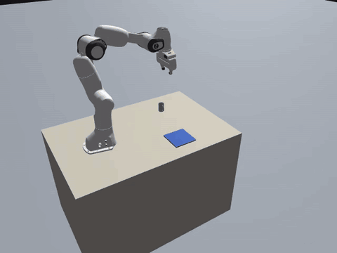
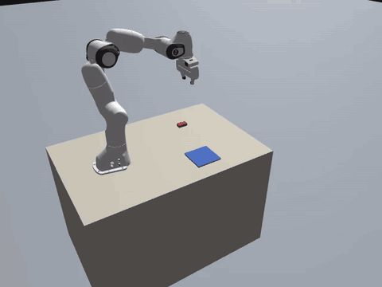
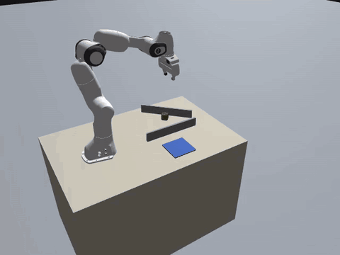
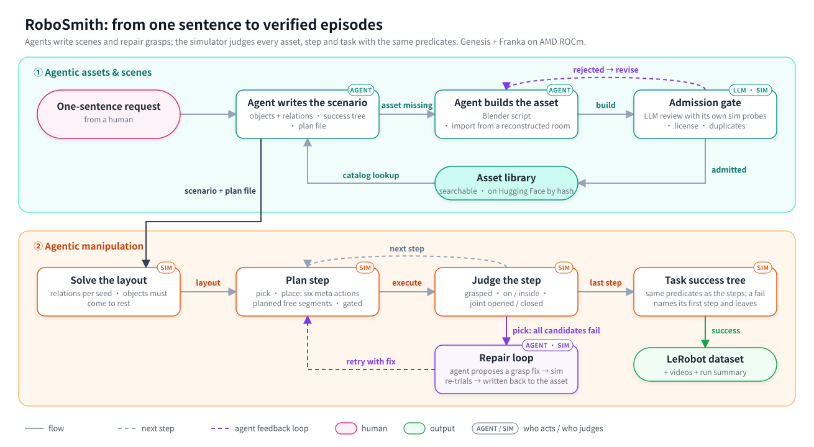

# RoboSmith

English | [中文](README.zh-CN.md)

**Test agentic robots and VLAs in a simulated twin of your own scene, on AMD ROCm.**

Standard benchmarks use curated scenes. RoboSmith asks whether an agent or a VLA can do the task in *your* scene.
It sets the exam: a twin of the scene, tasks with a success test the system under test never sees, and a proof that
each task is solvable. Your policy plugs in through [Inspect Robots](https://github.com/robocurve/inspect-robots)'s interface without code changes, and RoboSmith judges the run
from the simulation: whether the task holds at the end, and whether any physics step made an illegal contact.

Scenes are written as YAML today; turning a phone video into a twin is in progress.

| Mug onto the mat | Block onto the mat | Past two low walls (unseen layout) |
|---|---|---|
| [](videos/mug_on_mat_seed0.mp4) | [](videos/block_on_mat_seed0.mp4) | [](videos/f5_clutter_seed100.mp4) |

## What works today

| | |
|---|---|
| **Evaluating your agent** | An external policy runs through Inspect Robots' interface; RoboSmith judges the task and every contact from the simulation, and the saved log re-judges offline. One external LLM agent certified on the open-table task ([result](docs/evaluation.md#已测结果)). Not yet: VLAs, failures attributed to milestones, multi-scene reports. |
| **Assets** | Agents build objects, including articulated ones, as Blender programs; an LLM reviewer probes each in simulation before it is admitted. Admitted assets are published by hash to Hugging Face. |
| **Scenes and tasks** | One YAML file: objects, spatial relations, and a success test the robot never sees. A solver places the objects for each seed. |
| **Proving a task solvable** | A Franka picks and places: motions are planned in joint space, checked against the scene before they run, and every physics step is monitored for illegal contact. |
| **Real-video twins** | In progress: run on simulator footage, not yet on a real video. |

Every task is proved solvable before a policy is tested on it. These are RoboSmith's own runs, on one MI300X, ten
seeds each; *certified* means the task holds and no physics step made an illegal contact.

| Scene | Object | Certified |
|---|---|---|
| Open table | die · mug · block | 10/10 · 10/10 · 9/10 |
| Object against a low wall | die | 10/10 |
| A 20 cm wall between object and mat | die | 10/10 |
| Two low walls, held out during development | die | 10/10 |

These hold only for the scenes and seeds listed ([scope](docs/acceptance.md#certified-的适用边界)). Not yet: placing
onto shelves, objects heavier than about 0.2 kg, grasps chosen by an agent rather than fixed rules, and rendering good
enough for VLAs (MI300X renders in software).

## How it works



An agent-built asset library feeds YAML scenarios; the solver lays each one out in Genesis; the robot runs the
scenario's steps, each motion passing one safety check before it executes; the same predicates judge every step and
the task from the simulator state, and the state is saved so any run can be re-judged offline.

## Try it

Without a GPU, the package and its tests run anywhere:

```shell
python -m pip install -e ".[dev]"
python -m robotsmith.assets.fetch   # asset meshes are downloaded by hash, not stored in git
python -m pytest tests -q
```

On an AMD GPU node with ROCm and Docker, [Quick start](docs/quick-start.md) builds the image, certifies one instance,
and records the mug run above.

To test a policy, run inside that image:

```shell
python -m pip install -e ".[eval]"
python scripts/eval/run_exam.py --scenario scenarios/acceptance/f0_open.yaml --split playground --limit 1 --out out/exam
```

This runs Inspect Robots' LLM agent on the open-table task; set the `ROBOSMITH_LLM_*` variables for your model endpoint
first. What the policy sees, how it is scored and how to swap in your own: [Evaluation](docs/evaluation.md).

## Roadmap

The goal is one real tabletop scene, a few tasks, one system under test and one report:

```text
RoboSmith eval  scene: <your desk>  evaluatee: <agentic baseline>
task                          certified  success  failures
put the cup on the tray       10/10      6/10     never: grasped ×3 · lost: on ×1
put the pen into the holder   10/10      2/10     never: grasped ×5 · never: inside ×3
```

1. **Agentic manipulation:** an agent chooses and corrects grasps and placements inside an episode, with the safety
   check, the planner and trial grasps as its tools.
2. **More primitives:** press, push, rotate, hinged doors.
3. **A real scene:** a phone video of a desk turned into a twin.
4. **The evaluation layer:** failures attributed to milestones, multi-scene reports, VLAs (the interface and physical judging exist in a minimal form).

Results are measured in a twin, not on a real robot. Out of scope: curated benchmark suites, policy training,
sim-to-real research.

## Acknowledgments

The evaluation interface and the first policy under test come from [Inspect Robots](https://github.com/robocurve/inspect-robots) (robocurve, MIT). RoboSmith implements its
`Embodiment` protocol and runs its `agent` policy unchanged; judging is RoboSmith's own. Pinned at `7720195`
([details](docs/evaluation.md#inspect-robots-在-robosmith-里的位置)).

## Docs

[Quick start](docs/quick-start.md) · [Design](docs/design.md) · [Evaluation](docs/evaluation.md) · [Architecture](docs/architecture.md) ·
[Writing scenarios](scenarios/README.md) · [Acceptance](docs/acceptance.md)

v0.1.0 (2026-10-20) was a synthetic-data pipeline; scenario runs still record a LeRobot dataset. Changes land through
pull requests: [CONTRIBUTING.md](CONTRIBUTING.md), [AI_POLICY.md](AI_POLICY.md), [SECURITY.md](SECURITY.md).
License: Apache-2.0.
