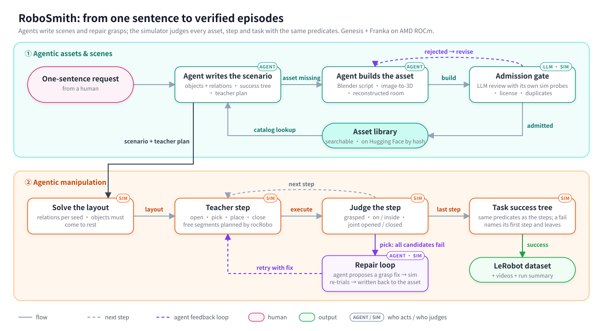

# RoboSmith

English | [中文](README.zh-CN.md)

**Evaluate agentic robots and VLAs in a simulated twin of a real scene, on AMD ROCm.**

v0.1.0 (2026-10-20) was a synthetic-data pipeline; development now targets evaluation, and data generation stays as
it is, with no new features.

## Goal

Standard benchmarks are many and their scenes are curated. The next question is whether an agent or a VLA can do the
task in *your* environment. RoboSmith answers it in simulation:

1. **World.** A video of a real scene becomes an interactive twin in Genesis: objects rest, movable objects are
   separate graspable assets, and the geometry is measured against the reconstruction. Missing objects are generated
   by agents and admitted by an LLM reviewer.
2. **Tasks.** An agent writes tasks on that scene. Each one is certified solvable: RoboSmith's own basic agentic
   manipulation completes it in the twin.
3. **Evaluation.** The system under test (an agentic robot, a VLA, any controller) runs through an interface that is
   not tied to any one framework; RoboSmith ships a basic agentic baseline. The judge reads the simulator state with
   a success tree hidden from the system under test, and every failure is attributed to a milestone that was never
   reached or reached and then lost.

**Claim boundary.** Results are measured in a twin of a real scene. No twin-versus-real-robot comparison has been run
yet, so they are not claims about real-robot performance.

**Not in scope.** A curated benchmark suite; policy training; sim-to-real research. Data generation is no longer a
product direction: episodes the certifier records stay available as a LeRobot dataset.

### Minimum viable product

One real tabletop scene, 3–5 tasks, one system under test, one report:

```text
RoboSmith eval  scene: <your desk> (video → twin, median geometry residual x cm)  evaluatee: <agentic baseline>
task                          certified  success  failures
put the cup on the tray       10/10      6/10     never: grasped ×3 · lost: on ×1
put the pen into the holder   10/10      2/10     never: grasped ×5 · never: inside ×3
claim boundary: twin results, no real-robot comparison
```

The MVP holds when a reader can tell how the system under test does on that desk and where it fails, and the scene
and tasks came from one video and agents, without hand tuning.

## Where it stands

The layers below the evaluation exist and run on curated scenes. These clips are RoboSmith's own manipulation
(the future certifier) at seed 0 on `main`, one MI300X:

<table align="center">
  <tr>
    <td width="50%">
      <a href="videos/pick_place_onto_supporter_ep000_up.mp4"></a>
    </td>
    <td width="50%">
      <a href="videos/pick_place_table_to_lower_shelf_ep000_up.mp4"></a>
    </td>
  </tr>
  <tr>
    <td align="center"><b>Two-tier supporter · side insertion</b><br>pick the die off the upper shelf, insert it into the lower one</td>
    <td align="center"><b>Table to lower shelf</b><br>pick the die off the table, insert it into the lower shelf</td>
  </tr>
</table>

| Scenario (seed 0, current `main`) | Steps | Result |
|---|---|---|
| `pick_place_onto_supporter` | pick → place | ✅ succeeds |
| `pick_place_table_to_lower_shelf` | pick → place | ✅ succeeds |
| `pick_place_into_drawer` | open → pick → place → close | ❌ the rocRobo service faults when planning the place, the transport falls back to an unchecked straight line and the object is lost |
| `pick_one_of_three` | pick | ❌ the grasp fails (candidates rejected for IK branch jumps, or the apple slips) |
| `behavior_living_radio`, `office48_desk`, `office48_phone` (imported scenes) | pick | ❌ the scene fails the rest check: objects are pushed about 0.1 m or lifted 6–15 cm when placed, although they settled when first imported |

What the MVP still needs, in order:

- **Basic agentic manipulation.** An agent writes the step list from the instruction and the scene's objects, the
  existing skills execute it, and each step is judged; plan-level failures go back to the agent (at most two
  re-plans), physical failures go to the repair loop or are reported, so tokens are not spent on trial and error.
  The skills themselves need hardening first: free segments without collision-blind fallbacks, and reliable grasps of
  regular objects in clutter. No cross-episode memory; setups that need memory, a VLA or perception use an external
  framework such as RPent.
- **Primitive coverage** for about 80% of common indoor tabletop tasks: press, push, rotate (knobs, levers) and
  revolute open / close on top of pick, place and prismatic open / close.
- **Annotation by agents.** Openings, handles and functional points of reconstructed objects are proposed by an agent
  and verified by simulation probes; only the certifier reads them, a system under test does not.
- **A real video in.** The reconstruction path (video → reference → agent-built room → snapshot import) has only been
  run on a simulated BEHAVIOR video with ground-truth depth and poses; with a real video, fidelity is measured against
  the reconstruction instead.
- **Imported scenes that rest.** The three imported scenes passed a 2 s settle check when imported and fail it now;
  the cause is not yet found.
- **Tasks on an imported scene.** The existing ones are a single pick; the agent has to write multi-step tasks against
  the scene's own objects, and the certifier has to complete them.
- **The evaluation layer.** A task package without the success tree, an interface for the system under test, a basic
  agentic baseline, never / lost attribution, and the report.

## How it works today



- **Assets.** Single objects from an LLM-written Blender script (the default), image-to-3D backends (TRELLIS.2,
  Hunyuan3D) followed by `mesh_to_urdf`, or objects of a reconstructed room imported as a snapshot, each compiled
  into its own asset. An asset is admitted when an LLM reviewer, writing its own simulation probes, accepts the current
  build, its license allows redistribution, and it duplicates nothing already admitted. Build files are published by
  hash to a Hugging Face dataset, so a fresh clone fetches the exact library.
- **Scenarios.** A YAML file of objects with relations (`on`, `near`, `clear_of`, `facing`) and a success tree
  hidden from the executor, plus a teacher plan of steps. An agent writes one from a one-sentence request and the
  catalog ([`scenarios/AGENT_PROMPT.md`](scenarios/AGENT_PROMPT.md)); a solver places the objects per seed, and a
  `split` field reserves playground and test seeds.
- **Manipulation.** `pick` tries geometric grasp candidates in simulation and executes the first that lifts; when all
  fail, an agent proposes a fix that is re-trialled and written back to the asset. `place` handles surfaces, side
  insertion into shelves and drawers; `open` / `close` drag prismatic joints. Free segments are planned with
  collision checks by [rocRobo](https://github.com/ZJLi2013/rocRobo) (JAX, sidecar container).
- **Verification.** Objects are checked to rest after placement; each step is judged by the predicate bound to it at
  load (`grasped`, `on` / `inside`, `joint_opened` / `joint_closed`), the same ones the task uses; a failed episode
  names its first failed step and the success-tree leaves that failed, and every verdict re-judges offline from the
  recorded state.

Runs on MI300 (gfx942) and MI350 (gfx950).

## Limitations

- One Franka at a table; prismatic joints only: no revolute open / close (doors, lids), push / press or bimanual tasks.
- Fingers are position-controlled: objects above about 0.2 kg slip; flat, wide objects have no candidate family.
- Contact segments are straight lines without collision checks, and a free segment falls back to one when
  `plan_motion` misses (logged as `collision-blind straight-line fallback`); both demo episodes above contain such
  segments.
- Rendering is software (llvmpipe) on MI300X, far from photo-real; a VLA under test needs appearance fidelity first.
- One scene per process; the first `plan_motion` of a new scene shape compiles for about 10 minutes.

More detail, per module, in [`docs/design.md`](docs/design.md#current-limits).

## After the MVP

In dependency order:

- More scenes, then room scale, together with a mobile manipulator.
- Appearance fidelity, so that VLAs can be evaluated.
- Adapters for external agent frameworks (for example RPent) through the same interface.
- One small twin-versus-real-robot comparison when a robot is available; only then can the claim go beyond the twin.
- Other embodiments: bimanual, humanoid.

## Get started

- [Quick start](docs/quick-start.md): from a fresh GPU node to a recorded episode.
- [Design](docs/design.md): data flow, modules, execution, verification, and the projects RoboSmith builds on.
- [Writing scenarios](scenarios/README.md).
- Blog post: [RoboSmith — a ROCm-native synthetic-data pipeline for embodied interactive manipulation](https://andyluo7.github.io/rocm/amd/mi300x/robotics/embodiedai/sdg/2026/07/01/robosmith-rocm-native-synthetic-data-pipeline/)
  (written when RoboSmith was positioned as a data pipeline).

## Contributing

All changes land through pull requests; see [CONTRIBUTING.md](CONTRIBUTING.md), [CODE_OF_CONDUCT.md](CODE_OF_CONDUCT.md),
and [AI_POLICY.md](AI_POLICY.md). Report vulnerabilities privately per [SECURITY.md](SECURITY.md).

## License

Apache-2.0, see [LICENSE](LICENSE).
