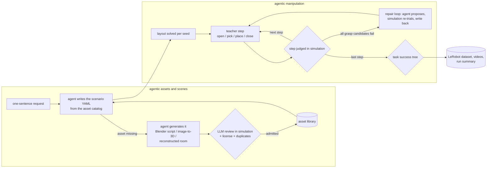

# RoboSmith

English | [中文](README.zh-CN.md)

**Agent-driven synthetic data generation for tabletop robot manipulation on AMD ROCm.**

RoboSmith has two halves, both run by agents and checked by the simulator. **Assets and scenes:** an agent writes a
scenario from a one-sentence request and the asset catalog, and generates any asset that is missing; an LLM
reviewer admits each asset only after probing it in simulation. **Manipulation:** a scripted expert (the teacher)
runs the scenario's steps in Genesis, every step is judged by the same predicates as the task, and the episodes that
succeed are recorded as a LeRobot dataset with videos. It is data infrastructure, not a policy-training framework.

<table align="center">
  <tr>
    <td width="50%">
      
    </td>
    <td width="50%">
      
    </td>
  </tr>
  <tr>
    <td align="center"><b>Two-tier supporter · side insertion</b> pick the die off the upper shelf, insert it into the lower one</td>
    <td align="center"><b>Table to lower shelf</b> pick the die off the table, insert it into the lower shelf</td>
  </tr>
</table>

Both clips are seed 0 on the current `main`, one MI300X: the pick is judged by both fingers on the object and its
lift, the place by the scenario's own `on` relation after a recorded 0.5 s hold, and the task by its success tree.

## How it works

## What it does today

- **Assets.** Single objects from an LLM-written Blender script (the default), image-to-3D backends (TRELLIS.2,
  Hunyuan3D) followed by `mesh_to_urdf`, or a room reconstructed from video and imported as a snapshot. An asset is
  admitted when an LLM reviewer, writing its own simulation probes, accepts the current build, its license allows
  redistribution, and it duplicates nothing already admitted. Build files are published by hash to a Hugging Face
  dataset, so a fresh clone fetches the exact library. The catalog is searchable by category and size.
- **Scenarios.** A YAML file of objects with relations (`on`, `near`, `clear_of`, `facing`) and a success tree
  hidden from the executor, plus a teacher plan of steps. An agent writes one from a one-sentence request and the
  catalog ([`scenarios/AGENT_PROMPT.md`](scenarios/AGENT_PROMPT.md)); a solver places the objects per seed.
- **Manipulation.** `pick` tries geometric grasp candidates in simulation and executes the first that lifts; when all
  fail, an agent proposes a fix that is re-trialled and written back to the asset. `place` handles surfaces, side
  insertion into shelves and drawers; `open` / `close` drag prismatic joints. Free segments are planned with
  collision checks by [rocRobo](https://github.com/ZJLi2013/rocRobo) (JAX, sidecar container).
- **Verification.** Objects are checked to rest after placement; each step is judged by the predicate bound to it at
  load (`grasped`, `on` / `inside`, `joint_opened` / `joint_closed`), the same ones the task uses; a failed episode
  names its first failed step and the success-tree leaves that failed, and every verdict re-judges offline from the
  recorded state.

| Scenario (seed 0, current `main`) | Steps | Result |
|---|---|---|
| `pick_place_onto_supporter` | pick → place | ✅ succeeds |
| `pick_place_table_to_lower_shelf` | pick → place | ✅ succeeds |
| `pick_place_into_drawer` | open → pick → place → close | ❌ the rocRobo service faults when planning the place, the transport falls back to an unchecked straight line and the object is lost |
| `pick_one_of_three` | pick | ❌ the grasp fails (candidates rejected for IK branch jumps, or the apple slips) |
| `behavior_living_radio`, `office48_desk`, `office48_phone` | pick | ❌ the imported scene fails the rest check (objects knocked off or tipped when placed) |

Runs on MI300 (gfx942) and MI350 (gfx950).

## Scope

In scope: agent-generated assets and scenes, and agent-assisted tabletop manipulation with step-level verification.
Out of scope: training and evaluating policies on the data (`scripts/train_smolvla.py` stays as an entry, its effect
untested) and generating indoor rooms (a room enters only by importing a reconstruction, and only the table region
the arm reaches is kept).

## Limitations

- One Franka at a table; prismatic joints only: no revolute open / close (doors, lids), push / press or bimanual tasks.
- Fingers are position-controlled: objects above about 0.2 kg slip; flat, wide objects have no candidate family.
- Contact segments are straight lines without collision checks, and a free segment falls back to one when
  `plan_motion` misses (logged as `collision-blind straight-line fallback`); both demo episodes above contain such
  segments.
- The repair loop covers grasps; the task-level loop (a grasp that succeeds and a later step that fails) has no case
  to work on outside the drawer.
- One scene per process; the first `plan_motion` of a new scene shape compiles for about 10 minutes.

More detail, per module, in [`docs/design.md`](docs/design.md#current-limits).

## Roadmap

Within the two halves above:

- **Feedback for scene and asset generation:** per-object comparison of the rendered scene with a reference image
  (size, offset, overlap) and finer physical gates (penetration, rest drift), so an agent can iterate on numbers and
  the LLM reviewer judges what numbers cannot.
- **Planning coverage:** fewer `plan_motion` misses (unreachable endpoints, segments that start or end in contact),
  and a fix for the fault on the drawer place that blocks `pick_place_into_drawer`.
- **Task-level repair loop end to end,** on the first real case of a grasp that succeeds and a later step that fails;
  physics-parameter variation (friction, mass) as a way to surface such cases.
- **Revolute articulation** in the collision world and the drag skill.
- **Grip:** force-controlled closing for heavier objects.
- **Imported rooms that pass the rest check,** starting from the collision bodies of reconstructed assets.

## Get started

- [Quick start](docs/quick-start.md): from a fresh GPU node to a recorded episode.
- [Design](docs/design.md): teacher and student, data flow, modules, execution, verification, and the projects
  RoboSmith builds on.
- [Writing scenarios](scenarios/README.md).
- Blog post: [RoboSmith — a ROCm-native synthetic-data pipeline for embodied interactive manipulation](https://andyluo7.github.io/rocm/amd/mi300x/robotics/embodiedai/sdg/2026/07/01/robosmith-rocm-native-synthetic-data-pipeline/).

## Contributing

All changes land through pull requests; see [CONTRIBUTING.md](CONTRIBUTING.md), [CODE_OF_CONDUCT.md](CODE_OF_CONDUCT.md),
and [AI_POLICY.md](AI_POLICY.md). Report vulnerabilities privately per [SECURITY.md](SECURITY.md).

## License

Apache-2.0, see [LICENSE](LICENSE).
