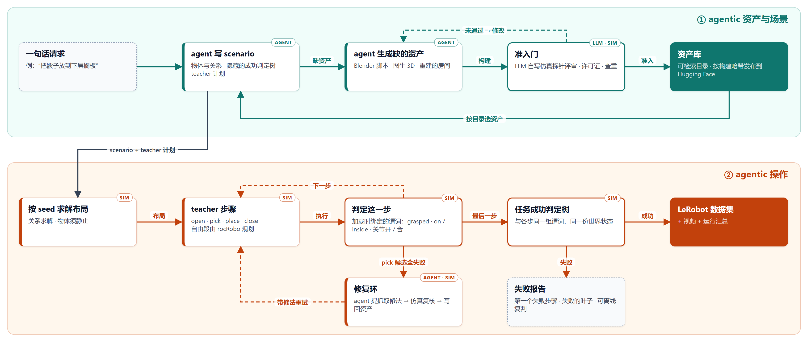

# RoboSmith

[English](README.md) | 中文

**AMD ROCm 上、由 agent 驱动的桌面机器人操作合成数据生成。**

RoboSmith 分两半，都由 agent 操作、由仿真验证。**资产与场景**：agent 按一句话请求和资产目录写出 scenario，缺什么资产就
生成什么；每件资产要经 LLM 评审在仿真里取证通过才准入。**操作**：脚本化专家（teacher）在 Genesis 里执行 scenario 的
各个步骤，每一步都用与任务相同的谓词判定，成功的 episode 录成带视频的 LeRobot 数据集。它是数据基础设施，不是策略训练框架。

<table align="center">
  <tr>
    <td width="50%">
      
    </td>
    <td width="50%">
      
    </td>
  </tr>
  <tr>
    <td align="center"><b>双层支架 · 侧插</b> 从上层取骰子，插入下层</td>
    <td align="center"><b>桌面到下层搁板</b> 从桌上取骰子，插入下层搁板</td>
  </tr>
</table>

两段都是当前 `main` 上的 seed 0、单卡 MI300X：pick 按「双指接触物体且抬起」判，place 在录制的 0.5 s 静置后按 scenario
自己的 `on` 关系判，任务按成功判定树判。

## 工作流程

## 现在能做什么

- **资产。** 单个物体由 LLM 写 Blender 脚本生成（默认），也可走图生 3D 后端（TRELLIS.2、Hunyuan3D）再接
  `mesh_to_urdf`，或把视频重建出的房间按快照导入。资产要在当前构建上有 LLM 评审（自己写仿真探针）的通过记录、许可证
  允许再分发、且不与已准入资产重复，才能准入。构建文件按哈希发布到 Hugging Face 数据集，新 clone 能拉到完全一致的资产库；
  目录可按类别与尺寸检索。
- **Scenario。** 一个 YAML 文件：物体及其关系（`on`、`near`、`clear_of`、`facing`）和对执行方隐藏的成功判定树，旁边配一份
  teacher 的步骤计划。agent 按一句话请求和资产目录写出它（[`scenarios/AGENT_PROMPT.md`](scenarios/AGENT_PROMPT.md)），
  求解器按 seed 摆放物体。
- **操作。** `pick` 在仿真里逐个试几何抓取候选，执行第一个能抬起的；全部失败时，agent 提出修法，复核通过后写回资产。
  `place` 支持放上台面、侧插进搁板与放进抽屉；`open` / `close` 拖动棱柱关节。自由段由 [rocRobo](https://github.com/ZJLi2013/rocRobo)
  做带碰撞检查的规划（JAX，sidecar 容器）。
- **验证。** 放置后先检查物体是否静止；每一步按加载时绑定的谓词判（`grasped`、`on` / `inside`、`joint_opened` /
  `joint_closed`），与任务用的是同一组；失败的 episode 给出第一个失败的步骤和失败的判定树叶子，所有结论都能从记录的状态离线复判。

| Scenario（seed 0，当前 `main`） | 步骤 | 结果 |
|---|---|---|
| `pick_place_onto_supporter` | pick → place | ✅ 成功 |
| `pick_place_table_to_lower_shelf` | pick → place | ✅ 成功 |
| `pick_place_into_drawer` | open → pick → place → close | ❌ 规划放置时 rocRobo 服务出错，搬运退回不检查碰撞的直线，物体脱手 |
| `pick_one_of_three` | pick | ❌ 抓取失败（候选试抓时 IK 跳支被拒，或苹果滑脱） |
| `behavior_living_radio`、`office48_desk`、`office48_phone` | pick | ❌ 导入场景过不了静止检查（物体一放下就被弹开或翻倒） |

支持 MI300（gfx942）与 MI350（gfx950）。

## 范围

在范围内：agent 生成资产与场景，以及带逐步验证的 agentic 桌面操作。不在范围内：用这些数据训练、评测策略
（`scripts/train_smolvla.py` 作为入口保留，效果未验证），以及生成室内房间（房间只能靠导入重建结果进来，且只保留机械臂
够得着的桌面区域）。

## 限制

- 单台 Franka、一张桌子；关节只支持棱柱关节：没有转动关节的开关（门、盖子）、推按，也没有双臂任务。
- 手指是位置控制：约 0.2 kg 以上的物体会滑脱；扁平宽件没有候选族。
- 接触段是不检查碰撞的直线，`plan_motion` 规划不出时自由段也退回这样的直线（日志记为
  `collision-blind straight-line fallback`）；上面两段 demo 里都有这样的段。
- 修复环覆盖抓取；任务级修复（抓取成功、后续步骤失败）在 drawer 之外还没有可修的样例。
- 一个进程只能建一个场景；新场景形状的第一次 `plan_motion` 要编译约 10 分钟。

按模块的细节见 [`docs/design-cn.md`](docs/design-cn.md#当前限制)。

## Roadmap

都在上面两半之内：

- **给场景与资产生成补上可量化的反馈：** 渲染场景与参考图逐物体对比（尺寸、偏移、重叠），加上更细的物理门（穿透、
  静止漂移），让 agent 能按数字迭代，LLM 评审只判数字说明不了的部分。
- **规划覆盖：** 减少 `plan_motion` 规划不出的段（终点不可达、起止点处于接触），并修好卡住 `pick_place_into_drawer`
  的 drawer 放置规划故障。
- **任务级修复环端到端：** 等到第一个真实的「抓取成功、后续步骤失败」样例；用物理参数扰动（摩擦、质量）主动暴露这类失败。
- **转动关节**：碰撞世界与拖动技能都要支持。
- **夹持：** 闭合时改为力控，夹住更重的物体。
- **能过静止检查的导入房间：** 从重建资产的碰撞体入手。

## 上手

- [Quick start](docs/quick-start.md)：从一台全新 GPU 节点跑出第一条 episode。
- [设计](docs/design-cn.md)：teacher 与学生、数据流、模块、执行、验证、依赖的上游项目（[英文版](docs/design.md)）。
- [编写 scenario](scenarios/README.md)。
- 技术博客：[RoboSmith — 面向具身交互操作的 ROCm-native 合成数据管线](https://andyluo7.github.io/rocm/amd/mi300x/robotics/embodiedai/sdg/2026/07/01/robosmith-rocm-native-synthetic-data-pipeline/)。

## 参与贡献

所有改动经 pull request 合入，见 [CONTRIBUTING.md](CONTRIBUTING.md)、[CODE_OF_CONDUCT.md](CODE_OF_CONDUCT.md)
与 [AI_POLICY.md](AI_POLICY.md)。安全问题按 [SECURITY.md](SECURITY.md) 私下报告。

## License

Apache-2.0，见 [LICENSE](LICENSE)。
