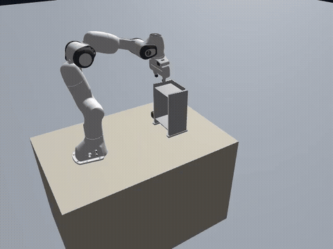
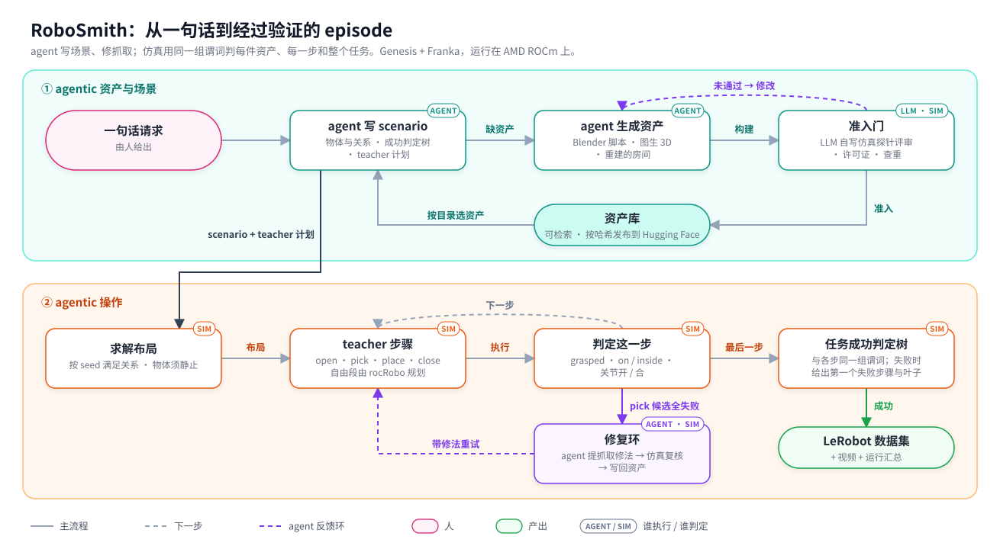

# RoboSmith

[English](README.md) | 中文

**在真实场景的仿真孪生里，评测 agentic 机器人与 VLA；运行在 AMD ROCm 上。**

v0.1.0（2026-10-20）是合成数据管线；此后的主线是评测，数据生成原样保留。

## Goal

标准 benchmark 用的是精选场景。RoboSmith 要回答：agent 或 VLA 进了*你的*场景，还能不能完成任务。

1. **世界：** 一段真实场景的视频变成 Genesis 里可交互的孪生：物体能静止，可移动物体是能抓的资产。
2. **任务：** agent 在这个场景上写任务，由 RoboSmith 自带的基本 agentic 操作证明每道可解。
3. **评测：** 被测方通过一个不绑定任何框架的接口执行。判定读仿真状态，成功判定树对被测方隐藏；每个失败给出从未达成或达成后丢失的里程碑。

结果是孪生里测得的；没做过孪生与真机对照，不代表真机表现。不在范围内：精选 benchmark 套件、策略训练、sim2real 研究。

**MVP：** 一个真实桌面场景、3–5 道任务、一个被测方、一份报告：

```text
RoboSmith eval  scene: <你的桌面>（视频 → 孪生，几何残差中位数 x cm）  evaluatee: <agentic 基线>
task                 certified  success  failures
把杯子放到托盘上      10/10      6/10     never: grasped ×3 · lost: on ×1
把笔放进笔筒          10/10      2/10     never: grasped ×5 · never: inside ×3
```

## 现状

RoboSmith 自带的操作在精选场景上，`main` 上 seed 0、单卡 MI300X：

<table align="center">
  <tr>
    <td width="50%"><a href="videos/pick_place_onto_supporter_ep000_up.mp4"></a></td>
    <td width="50%"><a href="videos/pick_place_table_to_lower_shelf_ep000_up.mp4"></a></td>
  </tr>
  <tr>
    <td align="center">从上层取骰子，插入下层</td>
    <td align="center">从桌上取骰子，插入下层搁板</td>
  </tr>
</table>

| Scenario（seed 0） | 结果 |
|---|---|
| `pick_place_onto_supporter`、`pick_place_table_to_lower_shelf` | ✅ |
| `pick_place_into_drawer` | ❌ 规划服务在放置时出错，搬运不检查碰撞，物体脱手 |
| `pick_one_of_three` | ❌ 抓取失败（IK 跳支或苹果滑脱） |
| `behavior_living_radio`、`office48_desk`、`office48_phone`（导入场景） | ❌ 物体一放下就被顶开或顶高；导入当时是能静止的 |

MVP 还要做的，按顺序：

1. **基本 agentic 操作。** agent 写步骤表，现有技能执行，每步判定；计划层失败交回 agent，物理层失败走修复环。不做跨 episode
   记忆（需要时用 RPent 这类外部框架）。技能先要加固：不再有碰撞盲段，规则物体在杂乱桌面上抓得稳。
2. **原语覆盖**常见室内桌面任务约八成：press、push、rotate、转动关节开合。
3. **真实场景：** 真实视频重建成能静止的孪生，开口、把手由 agent 标注、仿真验证。
4. **评测层：** 任务包、接口、never / lost 归因、报告。

## 现在怎么工作



- **资产：** 由 agent 生成（默认写 Blender 脚本），LLM 评审在仿真里取证后准入，按哈希发布到 Hugging Face。
- **Scenario：** YAML，写物体、关系、对执行方隐藏的成功判定树，以及 playground / test 两段 seed。
- **操作：** pick 用几何候选在仿真里试抓，全失败时 agent 修复环介入；place 支持台面、搁板、抽屉；棱柱关节开合；
  自由段由 [rocRobo](https://github.com/ZJLi2013/rocRobo) 规划。
- **验证：** 每一步和整个任务用同一组谓词读仿真状态判定，可离线复判。

主要限制：单台 Franka、一张桌子；手指位置控制（约 0.2 kg 以上会滑脱）；MI300X 上是软件渲染，还不适合评测 VLA；一个进程一个场景。
细节见 [`docs/design-cn.md`](docs/design-cn.md#当前限制)。

MVP 之后：房间尺度场景与移动操作、外观保真度与 VLA、外部 agent 框架适配器、有真机时做一次孪生与真机对照、其他具身。

## 上手

[Quick start](docs/quick-start.md) · [设计](docs/design-cn.md) · [编写 scenario](scenarios/README.md) ·
[技术博客](https://andyluo7.github.io/rocm/amd/mi300x/robotics/embodiedai/sdg/2026/07/01/robosmith-rocm-native-synthetic-data-pipeline/)（写于数据管线时期）

改动经 pull request 合入：[CONTRIBUTING.md](CONTRIBUTING.md)、[AI_POLICY.md](AI_POLICY.md)、[SECURITY.md](SECURITY.md)。License：Apache-2.0。
