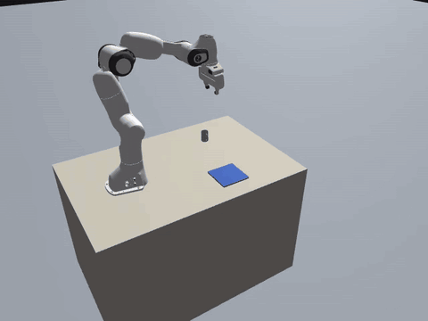
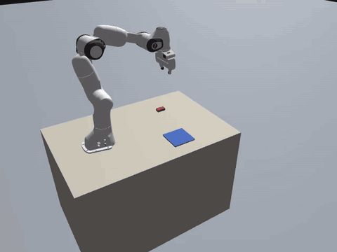
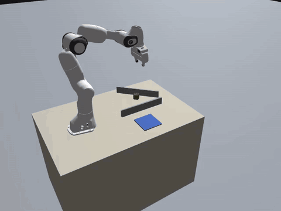
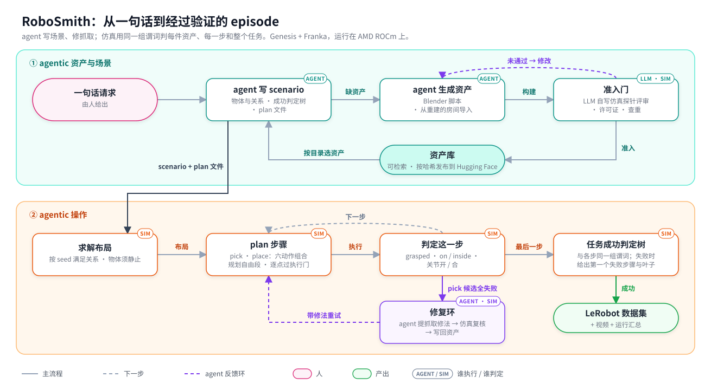

# RoboSmith

[English](README.md) | 中文

**在你自己场景的仿真孪生里测试 agentic 机器人与 VLA；运行在 AMD ROCm 上。**

标准 benchmark 用的是精选场景。RoboSmith 要回答：agent 或 VLA 进了*你的*场景，还能不能完成任务。
RoboSmith 负责出题：场景的孪生、被测方看不到成功判定的任务，以及每道题可解的证明。你的策略经 [Inspect Robots](https://github.com/robocurve/inspect-robots) 的接口接入，不用改代码；
RoboSmith 读仿真判卷：终态是否完成任务，每个物理步有没有违规接触。

现在的场景用 YAML 描述；手机视频变成孪生还在开发中。

| 杯子放到垫子上 | 方块放到垫子上 | 越过两道矮墙（开发期未见过的布局） |
|---|---|---|
| [](videos/mug_on_mat_seed0.mp4) | [](videos/block_on_mat_seed0.mp4) | [](videos/f5_clutter_seed100.mp4) |

## 现在能做什么

| | |
|---|---|
| **评测你的 agent** | 外部策略经 Inspect Robots 的接口接入；RoboSmith 读仿真判任务与每一次接触，保存的日志可离线复判。一个外部 LLM agent 在空桌面任务上 certified（[结果](docs/evaluation.md#已测结果)）。还没有：VLA、按里程碑归因失败、多场景报告。 |
| **资产** | agent 用 Blender 程序生成物体（含铰接件）；独立的 LLM 评审在仿真里取证后才准入。准入资产按 hash 发布到 Hugging Face。 |
| **场景与任务** | 一个 YAML 文件：物体、空间关系，以及机器人看不到的成功判定。求解器按 seed 摆放物体。 |
| **证明任务可解** | Franka 抓放：动作在关节空间规划，执行前对照场景检查，执行时逐物理步监测有无违规接触。 |
| **真实视频孪生** | 进行中：在仿真视频上跑过，真实视频还没有。 |

每道题在拿来考之前，先由 RoboSmith 自己证明可解。下表是 RoboSmith 自己的运行，单卡 MI300X，每项 10 个 seed；
*certified* = 任务成立，且没有任何物理步发生违规接触。

| 场景 | 物体 | certified |
|---|---|---|
| 空桌面 | 骰子 · 杯子 · 方块 | 10/10 · 10/10 · 9/10 |
| 物体贴着矮墙 | 骰子 | 10/10 |
| 物体与垫子之间有 20 cm 高墙 | 骰子 | 10/10 |
| 两道矮墙（开发期全程封存） | 骰子 | 10/10 |

这些结论只对表中的场景与 seed 成立（[适用边界](docs/acceptance.md#certified-的适用边界)）。还做不到：放到货架上、约 0.2 kg
以上的物体、由 agent 而不是固定规则选抓法，以及够 VLA 用的渲染（MI300X 上是软件渲染）。

## 怎么工作



agent 生成的资产库供 YAML 场景取用；求解器在 Genesis 里摆出场景；机器人执行场景的步骤，每个动作执行前先过同一道安全检查；
每一步和整个任务都用同一组谓词读仿真状态判定，状态整份保存，任何一次运行都能离线复判。

## 上手

没有 GPU 也能装包、跑测试：

```shell
python -m pip install -e ".[dev]"
python -m robotsmith.assets.fetch   # 资产网格不在 git 里，按 hash 下载
python -m pytest tests -q
```

在装好 ROCm 与 Docker 的 AMD GPU 节点上，[Quick start](docs/quick-start.md) 带你构建镜像、证明一个实例、录出上面的杯子视频。

要考一个策略，在同一个镜像里：

```shell
python -m pip install -e ".[eval]"
python scripts/eval/run_exam.py --scenario scenarios/acceptance/f0_open.yaml --split playground --limit 1 --out out/exam
```

这会让 Inspect Robots 的 LLM agent 考空桌面任务；先设好指向你的模型端点的 `ROBOSMITH_LLM_*` 变量。策略看到什么、怎么判分、
怎么换成你自己的策略：[评测](docs/evaluation.md)。

## 路线图

目标是一个真实桌面场景、几道任务、一个被测方、一份报告：

```text
RoboSmith eval  scene: <你的桌面>  evaluatee: <agentic 基线>
task                 certified  success  failures
把杯子放到托盘上      10/10      6/10     never: grasped ×3 · lost: on ×1
把笔放进笔筒          10/10      2/10     never: grasped ×5 · never: inside ×3
```

1. **agentic 操作：** agent 在 episode 内选择并修正抓法与放法，安全检查、规划器与试抓是它的工具。
2. **更多原语：** press、push、rotate、转动门。
3. **真实场景：** 手机绕桌拍一段视频，变成孪生。
4. **评测层：** 按里程碑归因失败、多场景报告、VLA 接入（接口与物理判卷已有最小版本）。

结果在孪生里测得，不代表真机表现。不在范围内：精选 benchmark 套件、策略训练、sim2real 研究。

## 致谢

评测接口与第一个被测方来自 [Inspect Robots](https://github.com/robocurve/inspect-robots)（robocurve，MIT）。RoboSmith 实现它的 `Embodiment` 协议，原样运行它的 `agent` 策略；
判卷由 RoboSmith 自己完成。版本钉在 `7720195`（[说明](docs/evaluation.md#inspect-robots-在-robosmith-里的位置)）。

## 文档

[Quick start](docs/quick-start.md) · [设计](docs/design.md) · [评测](docs/evaluation.md) · [调用链](docs/call-chain.md) ·
[编写 scenario](scenarios/README.md) · [验收](docs/acceptance.md)

v0.1.0（2026-10-20）是合成数据管线；跑 scenario 仍会写 LeRobot 数据集。改动经 pull request 合入：
[CONTRIBUTING.md](CONTRIBUTING.md)、[AI_POLICY.md](AI_POLICY.md)、[SECURITY.md](SECURITY.md)。License：Apache-2.0。
