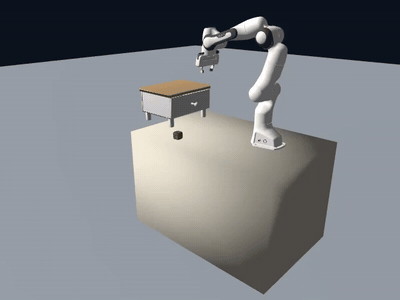
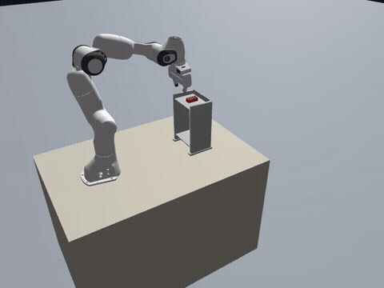

# RoboSmith

[English](README.md) | 中文

**AMD ROCm 上的机器人操作合成数据生成。**

RoboSmith 把资产和一段声明式任务变成录制好的专家 episode。你用几行 Python 写清桌上放什么、做哪几步、怎么算成功；
RoboSmith 在 Genesis 里搭场景、规划抓取和避障运动、跑 rollout，把成功的 episode 导出为带视频的 LeRobot 数据集。
它是数据基础设施，不是策略训练框架。

<table align="center">
  <tr>
    <td width="50%">
      
    </td>
    <td width="50%">
      
    </td>
  </tr>
  <tr>
    <td align="center"><b>抽屉 · 长程关节任务</b> open → pick → place → close</td>
    <td align="center"><b>双层支架 · 侧插</b> 从上层取物，插入下层</td>
  </tr>
</table>

## 能生成什么

| 资产类别 | 动作 | 成功谓词 |
|---|---|---|
| 刚体 | `pick`、`place`（GraspGen 给抓取候选） | `object_in_container`、`object_above`、`stacked`、`objects_aligned` |
| 关节 | `open`、`close`（棱柱关节） | `joint_opened`、`joint_closed` |

一个任务就是一个短 Python 文件：场景、技能意图、成功条件树。示例见
[`scenarios/pick_place_into_drawer.py`](scenarios/pick_place_into_drawer.py)。

## 上手

- [Quick start](docs/quick-start.md)：从一台全新 GPU 节点跑出第一条抽屉 episode。
- [Design](docs/design.md)：数据流、关键概念、代码结构、依赖的上游项目。
- [编写 scenario](scenarios/README.md)。
- 技术博客：[RoboSmith — 面向具身交互操作的 ROCm-native 合成数据管线](https://andyluo7.github.io/rocm/amd/mi300x/robotics/embodiedai/sdg/2026/07/01/robosmith-rocm-native-synthetic-data-pipeline/)。

支持 MI300（gfx942）与 MI350（gfx950）。运动规划来自 [rocRobo](https://github.com/ZJLi2013/rocRobo)，以 sidecar
容器运行。GraspGen 为 NVIDIA research / evaluation 许可，不随 RoboSmith 分发。

## 状态

[v0.1.0](CHANGELOG.md) 是脚本 teacher 数据生成器。生成数据对策略训练的效果尚未验证：还没有闭环评测入口。主要限制：

- 接触段是不做碰撞检查的直线，`plan_motion` 失败时也退化为直线。
- 关节只支持棱柱关节。
- 每个进程只能建一个场景。

## 参与贡献

所有改动经 pull request 合入，见 [CONTRIBUTING.md](CONTRIBUTING.md)、[CODE_OF_CONDUCT.md](CODE_OF_CONDUCT.md)
与 [AI_POLICY.md](AI_POLICY.md)。安全问题按 [SECURITY.md](SECURITY.md) 私下报告。

## License

Apache-2.0，见 [LICENSE](LICENSE)。
