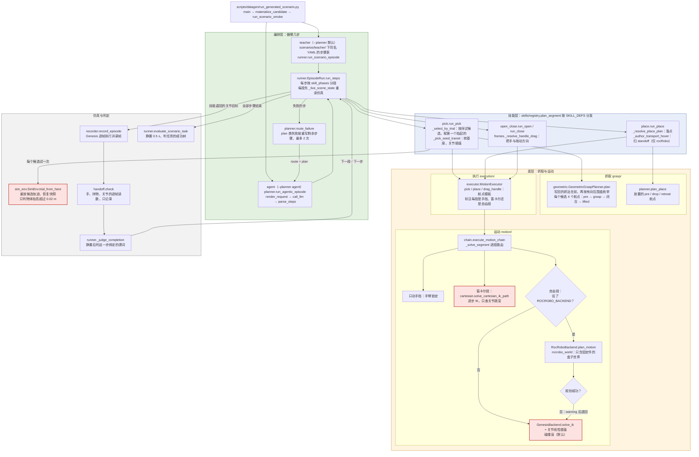

# 调用链：一次 scenario episode 怎么跑

开发文档，画 `main` 上的现状，粒度到函数；设计（要保证什么）在 [system-design](system-design.md) 与 [manipulation](manipulation.md)。改了这条链的 PR 同时改这里。

**默认路径上没有一处在执行前检查动作是否可行**：抓取候选只看能否抬起，自由段是碰撞盲的 IK 插值，开 rocRobo 时规划失败也退回碰撞盲直线。

## 四层

| 层 | 回答什么 | 组件（模块） |
|---|---|---|
| 编排层 | 做哪几步、失败后怎么办 | `scenarios/teacher/`、`scenario_runtime/planner.py`、`scenario_runtime/runner.py` 的 `EpisodeRun` |
| 技能层 | 一步（pick / place / open / close）怎么变成一串关节目标 | `skills/` |
| 底层：抓取与运动 | 抓哪里、航点是什么、每段怎么解出关节 | `grasp/`、`execution/`、`motion/` |
| 仿真与判定 | 执行、录帧、判这一步和整个任务成没成 | `sim/`、`scenario_runtime/handoff.py`、`tasks/`；判定函数住在 `runner.py` |

每个框写 `模块.函数`，框按所属模块放进层里；同一层内的子框是可以单独替换的组件。

红框是不查碰撞的地方。另有两段关节插值同样不经检查：`pick._pick_seed_transit` 的转基座，以及 rocRobo 关闭时 `place._place_transport_seed` 的搬运前转向。

## 不做检查的地方

| 位置 | 层 | 现在判什么 | 不判什么 |
|---|---|---|---|
| `SimEnv.trial_from_here` | 仿真与判定 | 物体终点比起点高 0.02 m | 重放过程中手、臂与固定件的接触 |
| `chain._solve_segment` 自由段，默认 | 底层 | IK 解出终点 | 路径与终点的碰撞 |
| `chain._solve_segment` 自由段，rocRobo | 底层 | rocRobo 的盒子世界里无碰撞 | 松散物体；规划失败后退回的直线 |
| 笛卡尔段 | 底层 | 相邻步关节跳变（pick 超限即拒，place / drag 不拒） | 碰撞 |
| `handoff.check` | 仿真与判定 | 持物距离、首次脱手帧、可能原因 | 不中断 episode，只记录 |

## 开关

| 开关 | 默认 | 作用 |
|---|---|---|
| `--planner` | `teacher` | 步骤表来自 YAML（`teacher`）还是 LLM（`agent`） |
| `--role` | `certifier` | agent 路径下是否看见成功树（`certifier` 看见，`baseline` 不看见） |
| `ROCROBO_BACKEND` | 未设 | 设了才构建碰撞世界、自由段走 rocRobo；需要 sidecar 容器 |
| `ROBOSMITH_LLM_*` | — | agent 路径调用的网关、模型与密钥 |

## 其他入口

单资产抓取验证（`scripts/datagen/validate_asset_picks.py` → `rollout/asset_pick_validation`）经 `skills.run_skills` 走技能层以下的同一套组件，不经编排层；修复环工具（`grasp/diagnostics/tool`）直接用 `GeometricGraspPlanner` 和试抓。
