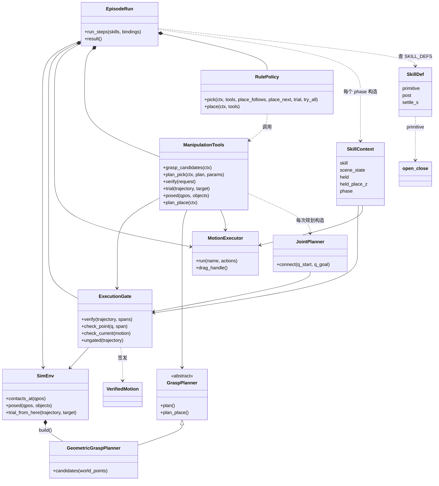
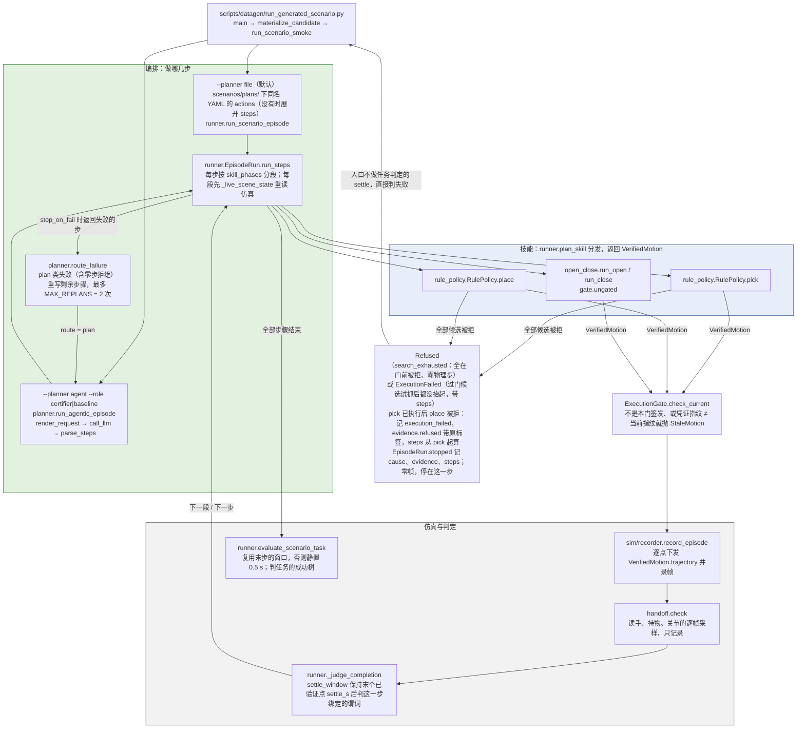
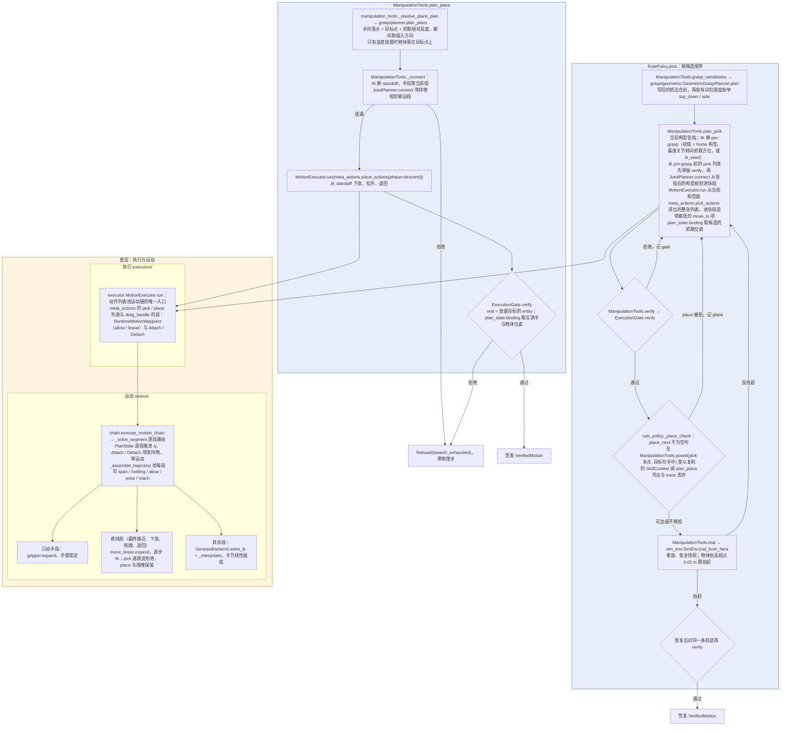
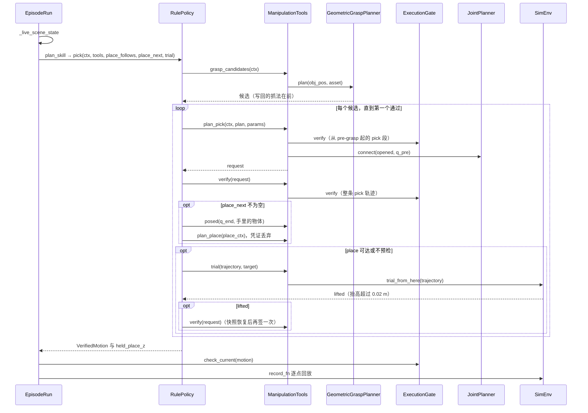

# 调用链：一次 scenario episode 怎么跑

开发文档，画 `main` 上的现状，粒度到函数；设计（要保证什么）在 [design](design.md) 与 [manipulation](manipulation.md)。改了这条链的 PR 同时改这里。

**每个被执行的关节目标都先经同一道执行门**：技能生成整条稠密轨迹，`ExecutionGate.verify` 对每个点调用
`check_point`（数值、关节限位、要到达的位姿、自碰撞与接触，接触在 Genesis 快照里查），`EpisodeRun` 回放前核对凭证是这道门
签发的、状态指纹没变，只回放签发过的原轨迹。门的接口与接触契约见
[manipulation](manipulation.md#执行门的接口与契约)。

## 四层

| 层 | 回答什么 | 组件（模块） |
|---|---|---|
| 编排层 | 做哪几步、失败后怎么办 | `scenarios/plans/`、`scenario_runtime/planner.py`、`scenario_runtime/runner.py` 的 `EpisodeRun` |
| 技能层 | 一步（pick / place / open / close）怎么变成一条过门的关节轨迹 | `skills/` |
| 底层：抓取与运动 | 抓哪里、航点是什么、每段怎么解出关节、哪个点合法 | `grasp/`、`execution/`、`motion/` |
| 仿真与判定 | 执行、录帧、判这一步和整个任务成没成 | `sim/`、`scenario_runtime/handoff.py`、`tasks/`；判定函数住在 `runner.py` |

每个框写 `模块.函数`，框按所属模块放进层里；同一层内的子框是可以单独替换的组件。

## 对象：一步 pick / place 由谁完成

实线箭头 = 持有（注入），菱形 = 自己创建，空心三角 = 继承，虚线 = 构造后交出或调用。`EpisodeRun.__init__` 创建
`ExecutionGate`、`ManipulationTools`（注入门、`env.planner`、执行器与 `GenesisBackend(env.solve_ik)`）与 `RulePolicy`；`env`、`executor` 由入口传入；
`SimEnv.build` 把 `GeometricGraspPlanner` 存为 `planner`。`SKILL_DEFS` 里 pick / place 只带完成判据与 `settle_s`，规划由策略做；
open / close 仍走自己的 `primitive`。

- `ManipulationTools` 是 pick / place 里调用抓取规划器、`gate.verify`、`JointPlanner` 与 `trial_from_here` 的唯一一处，
  每次调用执行一个显式请求，不选候选、不重试。门与试抓都在调用时从 `gate` / `env` 上取，certify 包在它们外面的监听照样生效。
- `RulePolicy` 只做选择：候选顺序、place 预检、试抓与试抓后重签。
- 跨步依赖由 `runner.plan_skill` 显式传给策略：下一步是不是 place（`place_follows`，决定抬升后是否保持）、
  它是不是单阶段 place（`place_next`，决定预检哪个 place）、试抓（`trial`，规划器是 `GeometricGraspPlanner` 时为 `tools.trial`）
  与 `try_all`。pick 返回的 `held_place_z` 由 `plan_skill` 交回 `EpisodeRun` 存下，下一步 place 从 `SkillContext` 读。

## episode：从入口到判定

技能内部见下一张图。file 与 agent 两条路径共用 `EpisodeRun`，只是步骤表的来源不同。plan 文件有 `actions`（六动作组合）时，
`scenario/load.actions_to_intents` 按 `sample` 把它切成 pick / place 两段，每个技能带着自己那段（`Skill.params["actions"]`）；
只有 `steps` 时（agent 写的步骤也是）`steps_to_intents` 把每步展开成公开组合的同一段（`pick_part` / `place_part`）。
段内顺序与公开组合不同、引用或物体不属于本段（`check_plan`）即加载时 `PlanInvalid`（[写法与报错](../scenarios/AGENT_PROMPT.md#plan-file-optional)）。pick 已走过物理步之后组合即提交，place 仍从实测状态重新规划，这时它被拒就记 `execution_failed`。agent 路径上零步拒绝（`Refused` 的标签）按
plan 类失败重写剩余步骤，`execution_failed` 按 physical 失败上报；重写后的步骤全部执行完，episode 就不再算被拒。

### 一步的数据表示：从 plan 文件到凭证

```mermaid
flowchart LR
    Y["plan YAML actions"] -->|check_plan<br/>actions_to_intents| I["SkillIntentSpec"]
    I -->|to_legacy_skills| S["Skill<br/>params actions"]
    S -->|EpisodeRun._plan → plan_skill| C["SkillContext"]
    C -->|pick_actions / place_actions<br/>按 PICK_ORDER / PLACE_ORDER| A["RuntimeMotionWaypoint<br/>与 Attach / Detach"]
    A -->|execute_motion_chain| M["MotionChainExecution<br/>segments"]
    M -->|spans_of / poses_of| P["Span"]
    P -->|ExecutionGate.verify| V["VerifiedMotion"]
```

段内顺序由 `meta_actions.check_part` 固定为一种，plan 能换的是物体、放置面、绑定名与抬升的方向和距离；四个验收族的
`actions` 相同。场景与任务另有两套类型：`scenario/specs` 的 `SceneSpec` / `TaskSpec` 经 `adapters.to_legacy_scene_config` /
`to_legacy_task_spec` 转成运行时的 `SceneConfig` 与 `tasks/task_spec.TaskSpec`（`materialize_candidate`）。

## 一个技能：候选、整条轨迹、过门

同一个 pick 按调用顺序（certify 用的 file 规划器，`grasp_selection="trial"`）：

试抓步进了物理，之前签发的凭证随状态指纹失效，所以抬起后要再 verify 一次。

门检查的是会被执行的每一个点：pick 的规划进场段、手指段与段后保持（含抬升后的保持）都在 `spans` 里，`spans` 必须铺满整条轨迹。
pick 的手指闭合段允许手指碰目标（`grip`），其后的直线抬升持物且允许离开支撑面（`rest`）；place 的规划搬运段持物，
下放持物且 `rest`，下放之后 detach，松指与退回 `grip`。持物段把目标摆在 手 · T，T 由技能以 `Holding` 传入，门在持物开始之前的构型上核对
手 · T 与目标位姿（≤ 5 mm / 0.05 rad）；detach 之后目标留在 手(最后持物点) · T，松指与退回时手掌碰到它会被拒绝。
航点到达点带期望手部位姿（`poses`），门判 FK 残差；自由插值的中间点不带。

`trial_all`（试遍全部候选，修复工具用）在最后一次试抓之后再按候选顺序对抬起者的原轨迹重新过门，第一个通过的被选中。

## 执行门的边界

| 位置 | 在门里 | 不在门里 |
|---|---|---|
| pick / place 的整条轨迹 | 每个点，含 pick 的规划进场段、place 的规划搬运段、手指与保持段；持物与松手后的物体；非相连连杆的自碰撞 | 相连（父子、同父）连杆的接触 |
| 试抓 `SimEnv.trial_from_here` | 试抓前后对同一条轨迹各过一次门 | 试抓本身是物理步进，判抬起，不判接触 |
| settle 与任务判定 `settle_window` | 只下发最后一个已验证点 | 保持期间的物理演化 |
| 开合抽屉 `open_close` | — | `gate.ungated`，不查接触；验收族里没有抽屉 |
| 场景初始化 `reset_scene` | — | 初始 reset / settle 属于场景初始化 |
| `handoff.check` | — | 持物距离、首次脱手帧、可能原因，只记录 |

## 运动层与执行门的接口

- `execution/gate.ExecutionGate`：`check_point(q, span, *, target, rest, held, placed, pose)` 返回 `None` 或拒绝原因；
  `verify(trajectory, spans, *, target, q_start, rest, holding, poses, budget)` 对每个点调它（给了 `budget` 就在每点前后
  调它的 `spend()` / `check()`），返回只读
  `VerifiedMotion(trajectory, spans, fingerprint, checked, gated, holding)`（轨迹与 `Holding` 的变换存为 `bytes`，每次读取
  得到新的只读视图，所以每次读 `trajectory` 都是新 tuple，certify 按内容把回放段对回凭证），违规抛 `MotionRejected(span, index, rejection)`；
  `check_current(motion)` 不是本门签发或指纹不一致抛 `StaleMotion`；`ungated(trajectory)` 只给开合抽屉。许可规则在
  `permitted`。步骤级结果 `Refused(label, evidence)`（`search_exhausted` / `unsupported` / `infeasible`，零物理步）与
  `ExecutionFailed(evidence, steps)` 也在这个模块。
- `sim/sim_env.SimEnv`：`contacts_at(qpos, held, placed)`、`hand_pose(qpos)`、`object_pose(name)` 在快照事务里查询，
  返回前还原；`joint_limits`、`joined_links`、`lever_arms(held)`（每个关节的力臂上界，持物算在手上）读机器人模型；
  `hold(qpos, name, T)` 把机器人与物体摆成持物起态，是一次不步进的真实写入；`state_fingerprint()` 带真实写入代次，
  `step()`、`reset()` 与 `hold()` 递增。`posed(qpos, objects)` 是不步进的摆放事务：手臂与给定物体摆到给定位姿，退出时还原；
  Genesis 的快照还原会丢掉未步进的写入，所以事务里每次查询还原后都重放摆放。事务期间指纹带事务序号，里面签发的凭证在事务外不当前。
- `motion/joint_planner.JointPlanner(env, gate, *, seed, max_queries, max_seconds).connect(q_start, q_goal, *, target, rest,
  holding, label)`：关节空间 lazy RRT-Connect，状态与按 `lever_arms` 细分到每步 ≤ 5 mm 的连边点只经 `check_point`，路径由
  `verify(..., budget=)` 签发，返回 `Connection(motion, queries, seconds, nodes, direct)`。搜索与签发共用一个 budget：
  1500 次查询或 30 s，`queries` 是门实际检查的点数；超出抛 `Refused("search_exhausted")`，不签发。`place` 用它规划搬运段，
  `pick` 用它从张指后的构型规划到 pre-grasp 的进场段。
- `motion/planner.MotionPlanner` 只有 `solve_ik(pos, quat, finger_pos, *, init_qpos)`；唯一实现 `GenesisBackend` 包装
  `SimEnv.solve_ik`。
- `motion/move_linear.expand(MoveLinear(start_pos, end_pos, quat, finger_width, on_jump, label), q_start, solve_ik)`
  把一段笛卡尔直线展开成关节路径：`start_pos` 是上一航点的名义位置，`q_start` 是逐点 IK 的初值，每 1 cm 一点、至多 24 点；
  单步关节变化超过 0.8 rad 时，`on_jump="refuse"` 抛 `RuntimeError("<label> IK discontinuity: ...")`，`"keep"` 返回路径并标
  `continuous=False`。零物理步、无状态，不签发凭证。
- `motion/gripper.expand(Gripper(pos, quat, finger_width), q_start, solve_ik)` 给只动手指的段算目标构型：臂关节取
  `q_start`，指关节取 `solve_ik(pos, quat, finger_width)` 的指关节（不带初值），返回 `GripperSegment(q_target)`。
  零物理步、无状态，不签发凭证，不改持物状态。
- `motion/plan_state.PlanState(q, holding)` 是预测构型与持物绑定；`attach(state, Holding)` / `detach(state)` 是改变持物的
  唯一途径，保持 `q`，在动作列表里写成 `Attach(holding)` / `Detach()` 两项。`binding(target, hand_pose, object_pose)` 给出
  `Holding(target, hand⁻¹ · object)`，pick 传候选抓取位姿，place 传实测手位姿。
- `motion/chain.execute_motion_chain(actions, motion_planner, start: PlanState, params)` 逐项执行动作列表：
  运动段做「航点 → IK（`finger_only` 段交给 `gripper.expand`，`linear` 段交给 `move_linear.expand`）→ 关节插值」，
  带 `path` 的 `move_to` 段直接取规划器给的点（空路径不动），
  `Attach` / `Detach` 在所在位置改持物、不加轨迹点、不占段号。返回 `MotionChainExecution`，每段带 `span`、`holding`、`allow`、
  航点位姿 `pose` 与到达下标 `reach`；`spans_of` 把它们转成门的 `Span`，`poses_of` 转成 `verify` 的 `poses`。
  每段从 `state.q` 起、段末推进到终点构型，段的 `holding` 读运行时的状态；末态在 `.state`。
  跳变策略写在航点的 `linear` 上：pick 的最终接近 `refuse`，pick 的抬升、place 的下放、退回与拖拽各段 `keep`。
- `execution/meta_actions.pick_actions(part, plan, start_q, start_hand, approach, params, solve_ik, *, grasp)` 与
  `place_actions(part, place_plan, params, *, phase)` 把技能带的 plan 段（`Skill.params["actions"]`）逐项译成动作列表：
  pick 是张指（起点已张开则 0 帧）→ 带规划路径的 `move_to` 到 pre-grasp → `move_linear` 到抓取位姿 → 合指（含 settle）→
  `Attach(grasp)` → 按段里的 `move_linear {direction, dist}` 直线抬升（公开组合是世界 +Z 0.10 m）；place 是搬运 → 直线下放 →
  `Detach()` → 松指 → 直线退回。`check_part` 在加载时确认段内顺序就是这一种。
  两张表只读候选的位姿与指宽，不读也不分类它的航点；
  `place` 的 `descend` 从当前构型先走一段到 standoff 的关节插值（规划搬运之后几乎不动），再下放、松手、退回。
- `MotionExecutor.run(name, actions, motion_planner, start: PlanState, params)` 是动作列表进运动链的唯一入口，
  把 trace 记为 `last_motion_trace`；pick 的 `lift_hold_steps` 是抬升项自己的 `hold_after_steps`。`drag_handle(..., action)` 也经它。
- `scenario/relations.rigid_moving_links`：关节子 link 加上与它固定连接的 link，给 `clear_of` 的扫掠占地用。
- `scenes/genesis_loader` 加载 Franka 时给 `gs.materials.Rigid(gravity_compensation=1.0)`：机器人连杆的重力被完全抵消，
  持物与其它物体照受重力，关节 PD 停在门检查过的命令构型上，不靠位置误差扛重力。门仍只判接触，回放仍是每点一次下发、
  一步物理、不确认到位。原因与限制见[机器人控制与回放](manipulation.md#机器人控制与回放)。
- 启动脚本 `scripts/setup/run_scenario.sh` 只挂仓库与 Hugging Face 缓存，不挂 Docker socket。

## 开关

| 开关 | 默认 | 作用 |
|---|---|---|
| `--planner` | `file` | 步骤表来自 plan 文件（`file`）还是 LLM（`agent`） |
| `--role` | `certifier` | agent 路径下是否看见成功树（`certifier` 看见，`baseline` 不看见） |
| `ROBOSMITH_LLM_*` | — | agent 路径调用的网关、模型与密钥 |

## 其他入口

- 单资产抓取验证（`scripts/datagen/validate_asset_picks.py` → `rollout/asset_pick_validation.run_asset_pick`）每个
  episode 建一个 `EpisodeRun`（`grasp_selection` 选 `trial` / `trial_all`），pick 带公开组合的 pick 段，走同一套技能、门与
  执行器；pick 停下时把 `cause`、`evidence`、`steps` 记进 `stopped`、零帧，不写 episode。
- 修复环工具（`grasp/diagnostics/tool.try_candidates`）把 agent 提出的抓法交给单资产入口，以 `trial_all` 试遍，
  所以同样只经门执行。单资产入口在第 0 个 episode 读 `GeometricGraspPlanner.last_plans`（最近一次 `plan()` 的全部候选），
  全部失败时写进诊断请求，这是它唯一的读者。

`GraspPlan` 的 `retreat_pos` / `retreat_quat` 只有 `plan_place` 填（放下后退回的位姿，`place_actions` 读）；pick 候选不带它们，
抬升由 plan 的 `move_linear` 段给。
