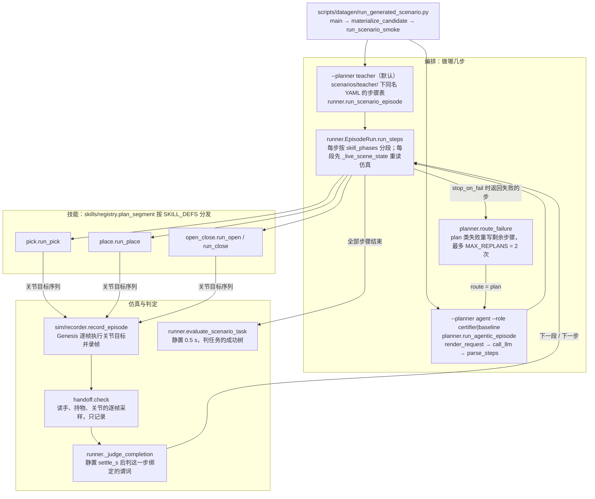
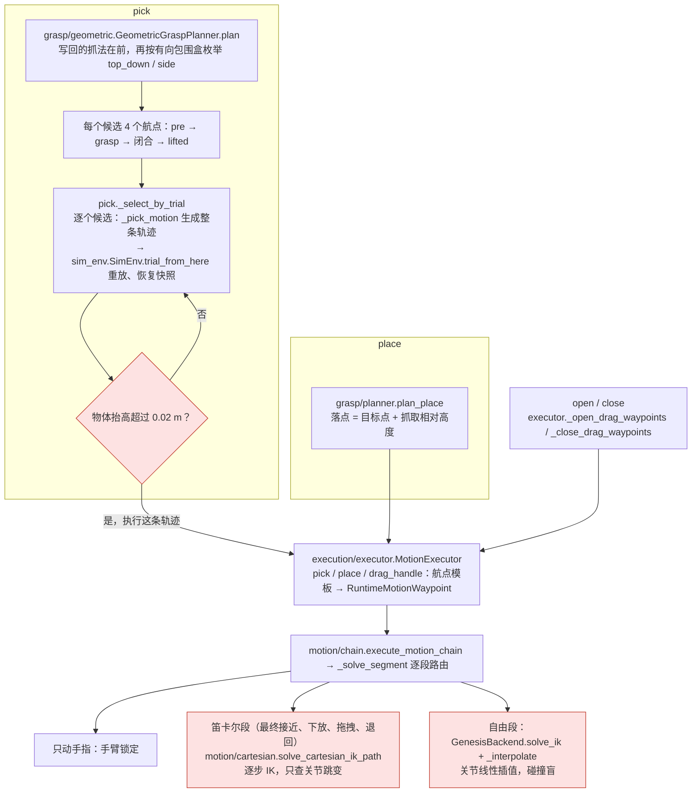

# 调用链：一次 scenario episode 怎么跑

开发文档，画 `main` 上的现状，粒度到函数；设计（要保证什么）在 [system-design](system-design.md) 与 [manipulation](manipulation.md)。改了这条链的 PR 同时改这里。

**链路上没有一处在执行前检查动作是否可行**：抓取候选只看能否抬起，自由段是碰撞盲的 IK 插值，笛卡尔段只查关节跳变。
要补上的执行门见 [manipulation](manipulation.md#执行门的接口与契约proposed尚未实现)。

## episode：从入口到判定

技能内部见下一张图。teacher 与 agent 两条路径共用 `EpisodeRun`，只是步骤表的来源不同。

## 一个技能：候选、航点、逐段求解

红框是不查碰撞的地方。pick 在航点之前另有一段转基座的关节插值（`pick._pick_seed_transit`），place 也有一段（`place._place_transport_seed`），两者都不经任何检查。

## 不做检查的地方

| 位置 | 现在判什么 | 不判什么 |
|---|---|---|
| `SimEnv.trial_from_here` | 物体终点比起点高 0.02 m | 重放过程中手、臂与固定件的接触 |
| `chain._solve_segment` 自由段 | IK 解出终点 | 路径与终点的碰撞 |
| 笛卡尔段 | 相邻步关节跳变（pick 超限即拒，place / drag 不拒） | 碰撞 |
| `handoff.check` | 持物距离、首次脱手帧、可能原因 | 不中断 episode，只记录 |

## 开关

| 开关 | 默认 | 作用 |
|---|---|---|
| `--planner` | `teacher` | 步骤表来自 YAML（`teacher`）还是 LLM（`agent`） |
| `--role` | `certifier` | agent 路径下是否看见成功树（`certifier` 看见，`baseline` 不看见） |
| `ROBOSMITH_LLM_*` | — | agent 路径调用的网关、模型与密钥 |

## 其他入口

单资产抓取验证（`scripts/datagen/validate_asset_picks.py` → `rollout/asset_pick_validation`）经 `skills.run_skills` 走同一套技能与执行器，不经 `EpisodeRun`；修复环工具（`grasp/diagnostics/tool`）直接用 `GeometricGraspPlanner` 和试抓。
