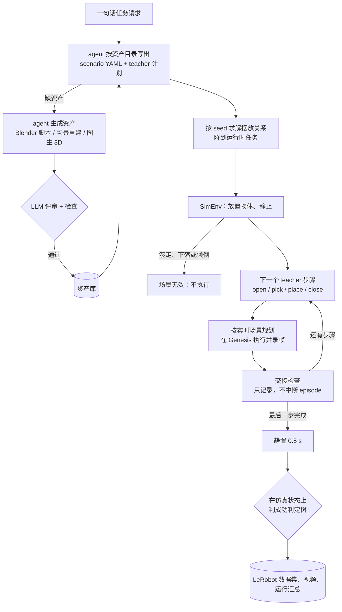
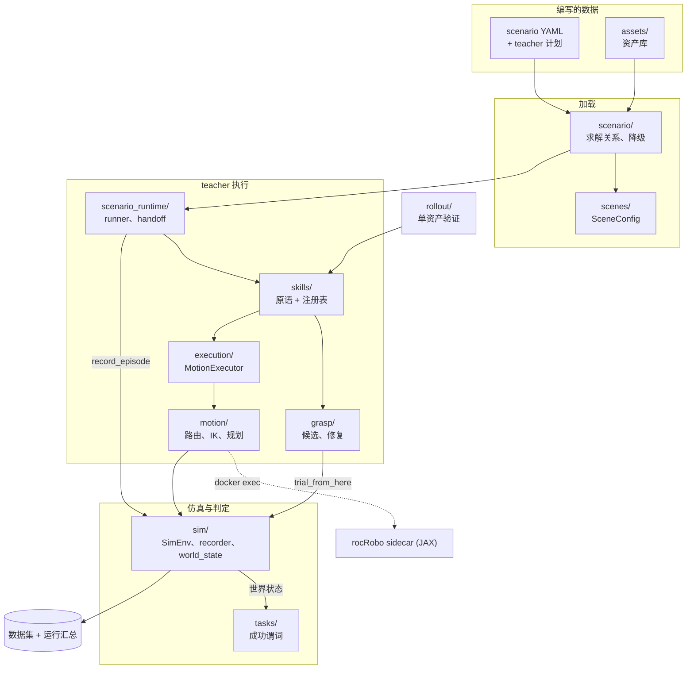
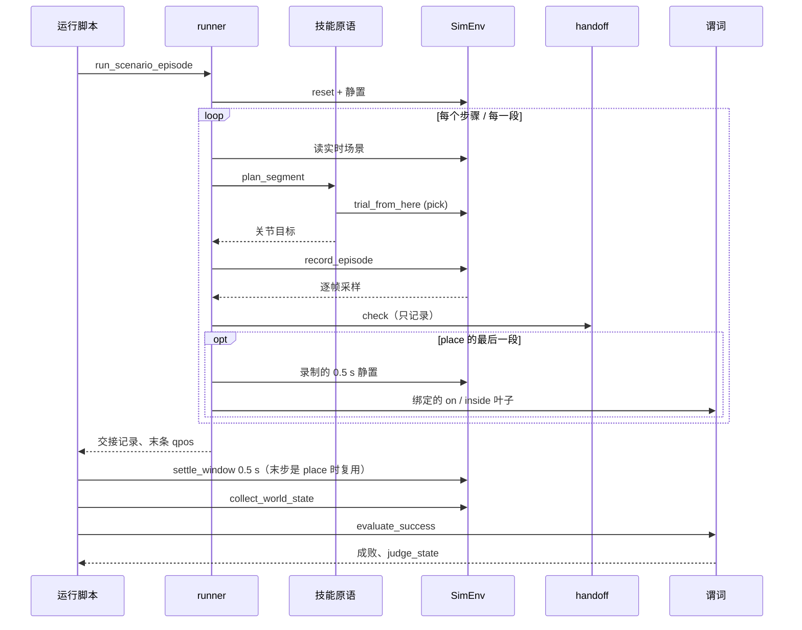
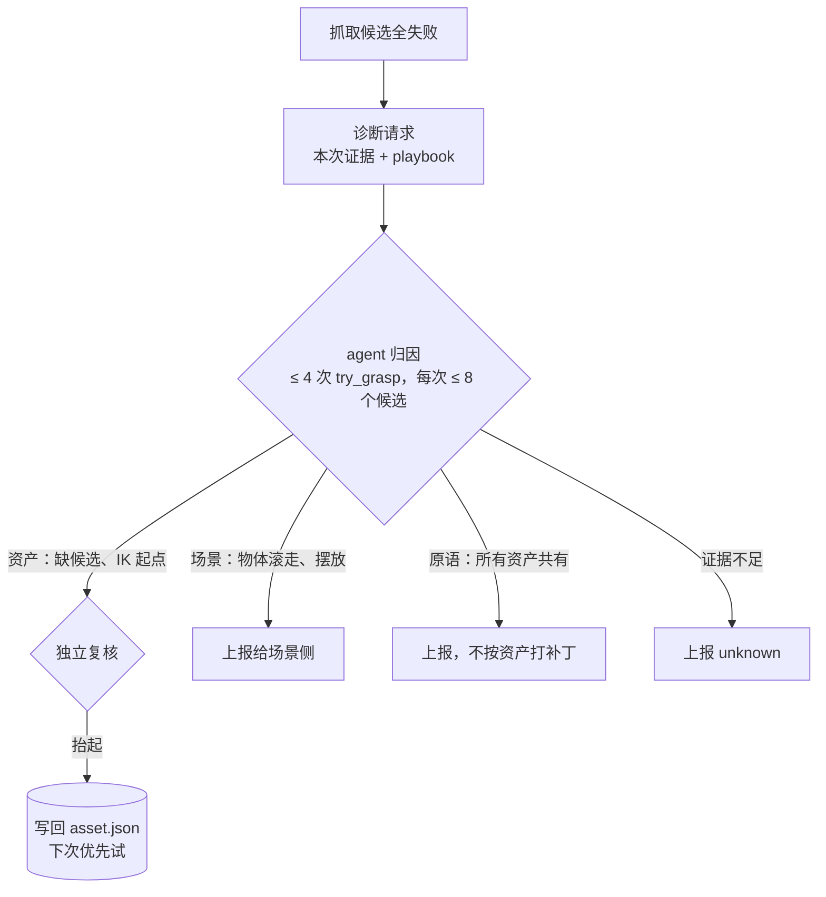

# RoboSmith 设计

> 英文版：[design.md](design.md)。两者不一致时以英文版为准。

RoboSmith 把**资产加一个声明式任务**变成**录成 LeRobot 数据集的成功专家 episode**。你只写要发生*什么*，RoboSmith
决定*怎么做*：搭场景、为每个 episode 选抓取、生成关节轨迹、在 Genesis 里执行，并把成功判定和数据存在一起。

它是数据基础设施，不是策略训练框架。唯一的训练入口 `scripts/train_smolvla.py` 消费 RoboSmith 写出的数据集。

## Teacher 与学生

- **Teacher** 是 RoboSmith 的脚本化专家。它读仿真真值：物体位姿和碰撞盒来自 Genesis，资产几何、关节和放置目标来自
  构建文件。它按一份脚本计划逐步执行技能，录下成功的 episode。它不用相机，也不用学出来的抓取模型；抓取是几何候选，
  在仿真里试抓选出。
- **学生**是用这些 episode 训练的策略，输入是真机能看到的东西：相机图像和本体状态，即数据集里的 `observation.*` 字段。
  RoboSmith 只负责产出它的数据；`scripts/train_smolvla.py` 是训练入口。

scenario 层以下的一切都为 teacher 服务：让它的 episode 成功，并且从仿真判断成没成，而不是相信计划。

## 数据流

每个箭头是一份有类型的契约，每一层在代码里只有一个归属：

| 契约 | 类型 / 模块 |
|---|---|
| 资产 → 资产库 | `asset.json` + `checks.jsonl`，评审通过才准入（`robotsmith/assets/store.py`） |
| 资产 → 场景 | `AssetMetadata`（`robotsmith/assets/`） |
| scenario → 运行时 | `robotsmith/scenario/load.py`、`robotsmith/scenario/adapters.py` |
| 抓取 → 执行 | `GraspPlan`，含其路点 |
| 修复 → 资产 | `grasp_candidates` 标注 + `trial_grasp` 检查记录（`robotsmith/grasp/annotations.py`、`grasp/diagnostics/`） |
| 执行 → 运动后端 | `MotionPlanner` 协议（`robotsmith/motion/`） |
| 仿真 → 判定 | `collect_world_state` / `settle_window`（`robotsmith/sim/world_state.py`） |
| 仿真 / 录制 | `robotsmith/sim/sim_env.py`、`robotsmith/sim/recorder.py`（唯一的两个适配层） |

## 模块

一次 scenario 运行中的主要调用方向（延迟导入双向都有，不画）：

| 包 | 负责什么 | 主要入口 |
|---|---|---|
| `assets/` | 资产库：加载、从构建文件推出几何、准入、查重、拉取 / 发布构建；`producers/` 生成新资产 | `AssetLibrary`、`AssetMetadata`、`derive.py`、`store.draft_reasons`、`dedup.check`、`review/` |
| `scenario/` | scenario YAML：schema、按 seed 的关系求解、成功判定树、teacher 计划；降到运行时 | `load.load_scenario`、`relations.solve`、`specs`（`SceneSpec`、`TaskSpec`、`SuccessSpec`）、`intents.SkillIntentSpec`、`adapters` |
| `scenes/` | 场景配置与加载进 Genesis | `SceneConfig`、`ObjectPlacement`、`genesis_loader` |
| `scenario_runtime/` | 一次 scenario 运行：实例化运行时包、驱动 episode、逐步交接检查 | `materialize_candidate`、`runner.run_scenario_episode`、`runner.evaluate_scenario_task`、`handoff.check` |
| `skills/` | 技能原语、完成条件及其注册表；按实时场景把一步变成关节目标 | `@register`、`SKILL_DEFS`、`plan_segment`、`skill_phases`、`Skill`、`SkillContext`、`frames.resolve_frame` |
| `grasp/` | 抓取与放置计划；几何候选；写回资产的抓法；修复环工具 | `GraspPlan`、`GeometricGraspPlanner`、`annotations`、`diagnostics/`（`request`、`tool`、`writeback`、`playbook.md`） |
| `execution/` | 把计划编译成运动链和关节轨迹 | `MotionExecutor` |
| `motion/` | 按段路由、IK 与考虑碰撞的规划、碰撞世界 | `chain.execute_motion_chain`、`MotionPlanner`、`GenesisBackend`、`RocRoboBackend`、`rocrobo_world` |
| `sim/` | Genesis 环境、Franka 常量、LeRobot 录制、判定读取的状态 | `SimEnv`（`reset`、`trial_from_here`）、`record_episode`、`collect_world_state`、`settle_window` |
| `tasks/` | 运行时任务与成功谓词 | `TaskSpec`、`SuccessNode`、`PREDICATE_REGISTRY`、`object_in_box`、`evaluate_success`、`JudgeInputError` |
| `rollout/` | 单资产抓取验证（及其诊断请求）、episode 布局、视频导出 | `asset_pick_validation`、`video_export` |

脚本：`scripts/datagen/run_generated_scenario.py` 运行一个 scenario；`scripts/datagen/validate_asset_picks.py` 逐资产验证
抓取（`--diagnose-dir` 写出修复请求）；`scripts/assets/list_assets.py` 是资产目录；`scripts/train_smolvla.py` 训练学生。

## 资产

一个资产是一个目录 `assets/<id>/`（`model.urdf`、`visual.*`、`collision.obj`、`provenance.json`、`asset.json`、
`checks.jsonl`）。`asset.json` 写明 `kind` 与 `category`；id 不带场景名，同一个资产可以出现在任何场景里。录下来的
房间是一个布局文件 `scenes/<name>.yaml`，列出资产 id 和位姿；scenario 引用它，而不是复制一份。新资产来自
`robotsmith/assets/producers/` 下的生成器：LLM agent 为单个物体写 Blender 脚本（`blender_item`，默认）、重建房间的
快照（`aha3d_snapshot`），或图生 3D 后端（TRELLIS.2 或 Hunyuan3D）再接 `mesh_to_urdf`。生成器把 `assets/<id>/` 写成
草稿；这些后端按需导入各自的模型仓库，在自己的镜像里运行，不在 Genesis 镜像里。

`asset.json` 记录 `kind`（`rigid`、`articulated`、`fixture`）、源文件与构建文件清单及构建文件的哈希、来源的 SPDX
`license` 与 `attribution`，以及标注；每条标注都记下是谁写的（`human`、`harness`、`agent:<model>`、
`check:<name>@<version>`，或迁移时不知道作者的 `legacy`）。`checks.jsonl` 只追加：每次检查一条记录，绑定资产
revision 和构建哈希；哈希和文件对不上的记录不算数。质量、惯量和关节限位只存在 URDF 里。加载器把这些组装成
`AssetMetadata`。

资产能做什么由标注决定，不由类别决定：

| 资产类型 | 解锁条件 | 动作 | 成功谓词 |
|---|---|---|---|
| 刚体 | 已准入、可抓取的网格 | `pick`、`place` | `inside` / `on`（`object_in_box`）、`lifted`、`stacked`、`aligned` |
| 关节体 | URDF 里有可动关节 + `handles` | `open`、`close` | `joint_opened`、`joint_closed` |
| 支撑物 / 固定件 | `kind: fixture` 或有任何可动关节 | 无（它是放置目标或障碍物） | — |

- **构建文件就是几何。** URDF 和网格以米为单位、`+Z` 朝上，所以资产坐标系就是直立的物体坐标系，场景只加一个位置
  和一个 yaw。点云、抓取判据、支撑面间隙都直接按文件计算，没有需要额外套用的缩放或直立标注。
- **准入门。** 资产在当前构建上有通过的 `llm_review` 记录、`source.license` 允许再分发（CC0-1.0、CC-BY-4.0、MIT、
  Apache-2.0、BSD-2/3-Clause）、且不与已准入资产重复时才准入；否则是草稿，`store.draft_reasons` 会说明哪一条不满足。
  scenario 拒绝草稿（`AssetNotAdmitted`），资产包只带已准入资产，`scripts/assets/list_assets.py` 显示每个资产的状态。
  scenario 下面的桌子是按 scenario 尺寸生成的实心块，地面是 Genesis 的平面，两者都不是资产。
- **评审。** `robotsmith/assets/review/` 打包评审者要看的东西：说明资产用途的请求、仿真坐标系下的渲染图、从构建文件
  推出的读数，以及 URDF。评审者（一个 LLM）自己写仿真探针、运行、给出结论；`admit` 把结论作为 `llm_review` 追加到
  `checks.jsonl`，绑定它评审的 revision 和构建哈希。挪动文件不会让任何资产准入。
- **查重。** `admit` 同时运行 `robotsmith.assets.dedup.check`，每个构建记录一次 `dedup_check`：新构建可能重复的已准入
  资产，即构建哈希相同，或类别、类型、可动关节、放置目标都相同且每条边相差不超过 20%。构建哈希相同直接拒绝；其余
  候选需要一位同时看过两者的评审给出 `dedup_review` 结论（`variant` 或 `duplicate`），绑定双方的 revision 与构建哈希。
  准入门只读这些记录，所以在没有构建文件的新 clone 上结果也一样；检查之后被重建或降级的候选不再计入。没有嵌入索引。
- **检索。** `AssetLibrary.search_assets(query, category=, size_cm=)` 返回某个类别的已准入资产，按尺寸最接近排序；
  不给类别时返回与查询词有共同词的资产。`list_assets.py --category --size --query` 输出同样的结果。agent 先按资产目录
  把请求映射到一个类别并检索，找不到再请生成器做新资产。
- **资产包。** 构建文件不进 git；git 跟踪 `asset.json`、`checks.jsonl` 和源文件。已准入资产的构建文件存在 Hugging Face
  数据集（`lidavidsh/robosmith-assets`）的 `<id>/<build_hash>/` 下，发布路径永不改变，`asset.json` 就是锁文件。
  `python -m robotsmith.assets.fetch` 下载缺失或哈希不符的文件，下载内容哈希对不上就拒绝；
  `python -m robotsmith.assets.package publish` 上传新构建并重新生成数据集卡片上的署名表。存储按构建哈希寻址，不按
  场景或类别，所以重组资产库不会移动已发布的文件。

几何在加载时从 URDF 和网格推出（`robotsmith/assets/derive.py`），不存储：`size_cm` 是显示几何的包围尺寸，任务关节就是
那个可动关节，把手或放置目标只指名一个 link 或碰撞盒，加载器在关节零位读出它的位置。标注只保留语义选择：哪个 link
是 `handle`，哪些盒子是 `place_targets`（可带一个插入方向 `approach`）。

## Scenario 与 teacher 计划

一个 scenario 是一个 YAML 文件：场景写成物体及其关系（`on`、`near`、`clear_of`、`facing`，每个固定件最多一个
`anchor_xy`），加上任务（指令 + 成功判定树）。它是数据，按 `robotsmith/scenario/load.py` 里的 JSON Schema 校验，其中
没有任何可执行内容。示例在 [`scenarios/`](../scenarios/)；写给 agent 的编写约定是
[`scenarios/AGENT_PROMPT.md`](../scenarios/AGENT_PROMPT.md)。

- **关系按 seed 求解**（`robotsmith/scenario/relations.py`），只用资产几何：显示包围盒、碰撞盒、放置目标和棱柱关节。
  `near: robot` 在 Franka 工作空间的环形区域内采样，所以一个 scenario 是一族布局；`variations` 按 seed 替换字段，
  `split` 为 playground 与 test 预留 seed 区间。
- **成功判定树**是由 `all_of` / `any_of` / `not` 组成的关系树（`on`、`inside`、`lifted`、`joint` 等），降成注册的谓词，
  判法见[验证](#验证)。这棵树本应对执行方隐藏。
- **Teacher 计划**（`scenarios/teacher/<name>.yaml`）是 teacher 依次执行的步骤，例如 `open: drawer`、`pick: die`、
  `place: {target: drawer.drawer_opening}`、`close: drawer`。它从不写路点、不控制夹爪、不调用 Genesis。关节固定件上的
  放置目标随关节打开而移动。

scenario 层有自己的 `TaskSpec`（只有任务、没有动作），在 `scenario/adapters.py` 里降成运行时的 `TaskSpec`
（`tasks/task_spec.py`，成功判定树加技能列表）；两个类同名，但职责不同。

## Teacher 执行

`scenario_runtime/runner.py::run_scenario_episode` 以分段闭环驱动一个 episode：每一步都重读实时场景、只规划这一步。

图中「技能原语」合指 `skills/`、`grasp/`、`execution/`、`motion/`。`plan_segment` 在 `SKILL_DEFS`（`skills/registry.py`）里找到这一步的原语，用 `SkillContext`（步骤、抓取规划器、
执行器、运动规划器、实时场景、当前关节目标）调用它。只有放到关节体目标上的 `place` 拆成 `transport` 和 `descend` 两段，
这样下降前会重读回弹后的抽屉；其他步骤都是一段。

### 抓取：几何候选，由试抓选出

单资产验证和 scenario 运行都只根据静止后物体的有向包围盒和 `GripperSpec` 生成候选（`grasp/geometric.py`），逐个在
仿真里试抓，取第一个能抬起物体的。单资产验证从放置后的起点试；scenario 从当前场景试（存快照、执行、恢复：
`SimEnv.trial_from_here`），已经打开的抽屉、已经移动过的物体保持原样。agent 写回资产的抓法（`grasp_candidates`，见
[修复环](#修复环)）排在最前面试。

不用学出来的抓取模型：试抓才是裁判，候选好坏只影响试几次；几何候选的失败 agent 读得懂（无候选、宽度超限、IK 跳支），
而且结果确定，bench 可复现；teacher 本来就有特权几何，不需要从图像估计抓取。

候选的形状由 Panda 的两个事实决定：

- **手指沿手的局部 Y 轴闭合**（`panda_finger_joint*` 的 `axis="0 1 0"`），所以手的旋转是
  `[finger × approach, finger, approach]`。
- **指垫比 TCP 低 8 mm**（`GripperSpec.pad_below_tcp`），所以 top-down 的 TCP 高度下限是物体底面 + `pad_below_tcp` +
  `support_clearance`（10 mm）。没有这个下限时，2.4 cm 高的物体，指垫末端离桌面只有 4 mm，加上约 3 mm 的跟踪下沉，
  闭合时会在桌面上拖。

夹持仍是未解决的问题。手指是位置控制，每指闭合目标 0.01 m 时，生成的 0.22 kg 订书机两个指垫都接触了却夹不住；
`finger_closed=0.0` 时能抬起。生成的 0.38 kg 胶带座即使在 0.0 下、两个指垫都在上面，也抬不起来。

### 运动：按段路由

每个技能都编译成一串路点，由 `motion/chain.py::execute_motion_chain` 执行。每一段按它是什么来路由，而不是按它属于
哪个技能：

| 段 | 路由 | 是否考虑碰撞 |
|---|---|---|
| 只动手指（闭合 / 张开夹爪） | 手臂锁定，手指运动 | — |
| 接触段（最终接近、拉把手、下降、侧插） | 笛卡尔直线 | 否，有意为之 |
| 自由段（接近、抬起、搬运、撤回） | 有碰撞世界时用 `plan_motion`，否则 IK + 插值 | 是（rocRobo） |

接触段从不做运动规划：靠近接触时，规划器绕出来的路线比一条受控的短直线更糟。笛卡尔段 IK 跳支的 pick 会被拒绝，而不是
硬执行。

### 运动后端与碰撞世界

`ROCROBO_BACKEND` 选择后端：

- **关** → `GenesisBackend`：只有 IK；`plan_motion` 总是失败，自由段走插值。
- **开** → `RocRoboBackend`：来自 [rocRobo](https://github.com/ZJLi2013/rocRobo)（JAX）的无碰撞 IK 与轨迹优化。JAX 和
  PyTorch 不适合共用一个 ROCm 进程，所以 rocRobo 跑在一个 sidecar 容器里，RoboSmith 通过 `docker exec` 用 JSONL 与它通信。

使用考虑碰撞的后端时，`motion/rocrobo_world.py::build_obstacle_world` 按实时位姿构建碰撞世界：固定件的碰撞盒加一个地面
半空间，关节件按当前关节值摆放（只支持棱柱关节）。`place` 期间，手里的物体以一组球体附着在手上，放置目的地（目标盒，
以及关节体目标的活动 link）从障碍中豁免。rocRobo 规划手臂的 7 个关节，客户端再把两个手指关节补回去。

如果 `plan_motion` 失败，这一段退回**不做碰撞检查**的直线；日志里的 `straight-line fallback` 标记了这种情况。

### 关节体

关节资产以 URDF 关节体加载，复位到关节值 0（或场景的 `joint_init`），关节值暴露在 `env_state.joint_positions` 里。
`open` / `close` 沿关节轴拖动把手（「open」指关节值增大），行程取 URDF 关节行程。`open → pick → place → close` 这类长程任务
在每一段都通过 `skills/frames.py::resolve_frame` 重新锚定到实时仿真，所以抽屉里的放置目标会随抽屉移动。

## 验证

三道检查都读仿真，都不相信计划。

1. **场景检查（第一步之前）。** `SimEnv.reset` 放置物体、静止，物体水平移动超过 5 cm、下落超过 5 cm 或倾斜超过 30°
   时抛 `SceneInvalid`。场景无效时不试抓、不诊断。
2. **交接检查（每步之后）。** `place` 在最后一段之后，按步骤绑定指向的关系（与任务同一个 `on` / `inside` 谓词）判定；
   判定前静置 0.5 s，这段静置录进 episode；结论、绑定与所判的状态都记在这一步上。未检查的绑定只记原因、不声称成功，
   两段式 place 的 `transport` 段不判。其余步骤仍由 `scenario_runtime/handoff.py::check` 用逐帧采样判断：`open` 关节位移
   达到请求行程的一半；`pick` 结束时物体距手 ≤ 0.15 m 且比起点高 ≥ 2 cm；`close` 关节回到 2 cm 以内。对 place，逐帧采样
   只作诊断：物体离手的帧、离手前的关节跳变和候选原因（`motion?`、`grip?`、`release?`）。失败的 episode 把第一个未完成的
   步骤记为 `failed_step`，步骤全过时记 `unknown`，并列出失败的判定树叶子。步骤结果不决定 episode 成败。
3. **任务成功（最后一步之后）。** `runner.evaluate_scenario_task` 让手臂保持最后的指令静置 0.5 s
   （`sim/world_state.py::settle_window`，判定代码里唯一推进仿真的地方；末步是 place 时复用它录下的静置，不再静置第二次），用 `collect_world_state` 读一步（位置、姿态、
   世界碰撞包围盒、实体级接触、关节），再用 `tasks/predicates.py::evaluate_success` 求值成功判定树：
   - `on` / `inside`（`object_in_box`）：物体包围盒对放置目标碰撞盒（随关节运动）——`on` 要中心在盒内，`inside` 要整个
     水平范围落在容器底板内，下沿距盒顶 2 cm 以内——且与目标所属资产有接触、不碰机器人、静置窗口内每帧相对末帧都在
     5 mm / 5° 以内。朝向不计入，立着放在板上的积木也算在板上；需要物体正立的任务另行声明。
   - `lifted`、`joint`（开 / 关）、`stacked`、`aligned` 读位置和关节值。
   - 观测缺失或非有限值时抛 `JudgeInputError`，不当作假。
   - run summary 记录实际求值的判定树（`success_tree`）和每个 episode 的判定状态（`judge_state`），离线复判结果相同。

已知近似：接触只到实体级（碰到柜子侧壁也算碰到柜子）；`inside` 不检查容器上界；父物体的 yaw 用加载时的值。

### 修复环

所有抓取候选都失败时，诊断工具让 agent 修复候选覆盖不到的情况：

经验存三处，每处只存验证过的：

| | 单资产抓法 | 诊断经验 | 原语修正 |
|---|---|---|---|
| 内容 | 修好的候选位姿、IK 起点 | 失败签名 → 方向 → 归属 | 夹爪、控制或候选规则 |
| 存哪 | `asset.json` 的 `grasp_candidates` + `checks.jsonl` 的 `trial_grasp` | `grasp/diagnostics/playbook.md` | 产品代码 |
| 写入前的验证 | 独立复核能抬起 | agent 拿已知样例能归对 | 既有回归 + 一件新资产 |
| 何时失效 | 资产重建、revision 变化或换机器人 | 对应原语修复合入 | — |

agent 可以提候选位姿与 IK 起点、提资产修正请求、标记场景问题；不可以改夹爪规格、控制参数或候选规则，也不能按资产单独
设控制参数。改构建文件的资产修正（质量、碰撞体、朝向）走重建和重新评审。`validate_asset_picks.py --diagnose-dir` 写出
请求；调起 agent 由调用方负责。

### 进行中：逐步检查与任务判定用同一套词汇

`place` 与成功判定树已经共用一套词汇；`pick`、`open`、`close` 仍是按技能写死的阈值。这次迁移在实施前先做了设计评审，
目标是每一步都读同一份世界状态、用同一组谓词：

1. 一个只读的世界状态采集入口和显式静置窗口——已完成（`sim/world_state.py`）。
2. 加载时把每个 teacher 步骤绑定到可判定的完成条件（place 绑定到成功判定树里、前一个 pick 拿起的物体对应的 `on` /
   `inside` 关系），矛盾在加载时报错——已完成（`scenario/adapters.py::to_step_bindings`）。
3. `place` 用共用谓词判定；中途静置走录制路径；步骤结果与任务结果分开输出——已完成（`SkillDef.post`、
   `runner._judge_completion`）。
4. `open` / `close` 按执行器解析出的具名关节判定。
5. `pick` 用手指级接触（`grasped`）加相对本步起点的抬升判定。

逐帧的交接采样保留为诊断，用来解释失败的步骤，不再决定成败。

## 执行与数据

每个 episode：把物体复位到求解出的位置，静止 `settle_steps`（30）步，把静止后的位姿记为初始状态，执行各步骤，再判定任务。
一次运行写出：

- 带 `up` 相机的 LeRobot 数据集；关节值追加到 `observation.environment_state`；
- 每个 episode 的视频，以及 `scenario_run_summary.json`（每个 episode 的成功与否、`judge_state`、交接、`failed_step` 与
  `failed_leaves`；`success_tree` 与 `step_bindings`；诊断与技能轨迹）。

## 当前限制

- **碰撞感知只覆盖自由段。** 接触段是直线，规划失败时退回不检查碰撞的直线。rocRobo 服务对某些请求会失败（drawer 的放置
  就是），这会静默地产生上述退化。
- 关节只支持棱柱关节；转动关节的开 / 关、推 / 按、双臂任务都未实现。
- 夹持是位置控制，较重的物体会滑脱（见[抓取](#抓取几何候选由试抓选出)）。
- 扁平宽件（平放的手机）没有候选族，修复环报 unknown。
- 生成资产可能直接拿不封闭的显示网格当碰撞体，复位时物体滚走；场景检查会拦下，修法在资产侧。
- `pick_one_of_three` 里快照试抓与执行有一处不一致，原因未查。
- 一个进程一个资产：`SimEnv.build` 每次都初始化 Genesis，同一进程里第二次 build 会失败。
- 新场景形状的第一次 `plan_motion` 要编译约 10 分钟，之后复用 JAX 磁盘缓存。
- 数据只来自脚本化的 IK 回放，还没有 DAgger 式或闭环的评测后端。

## 基于

- [Genesis](https://github.com/Genesis-Embodied-AI/Genesis)：GPU 物理仿真。
- [LeRobot](https://github.com/huggingface/lerobot)：数据集格式与 SmolVLA 训练入口。
- [rocRobo](https://github.com/ZJLi2013/rocRobo)，基于 [PyRoki](https://github.com/chungmin99/pyroki)：无碰撞 IK 与轨迹优化。
- [Objaverse](https://objaverse.allenai.org/) 与 [Articraft](https://github.com/mattzh72/articraft)：资产来源。
- [Blender](https://www.blender.org/)：LLM agent 以 Blender 脚本构建单物体资产。
- [Hugging Face Hub](https://huggingface.co/docs/hub/datasets)：按哈希存放构建文件的数据集。
- [TRELLIS.2](https://github.com/microsoft/TRELLIS.2) 与 [Hunyuan3D-2.1](https://github.com/Tencent-Hunyuan/Hunyuan3D-2.1)：
  生成资产用的图生 3D 后端。
