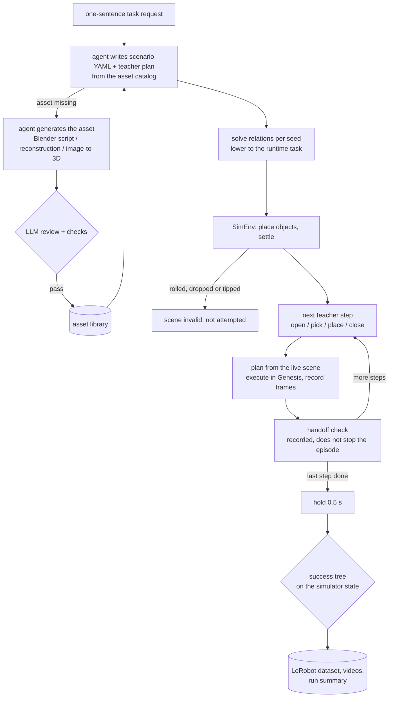
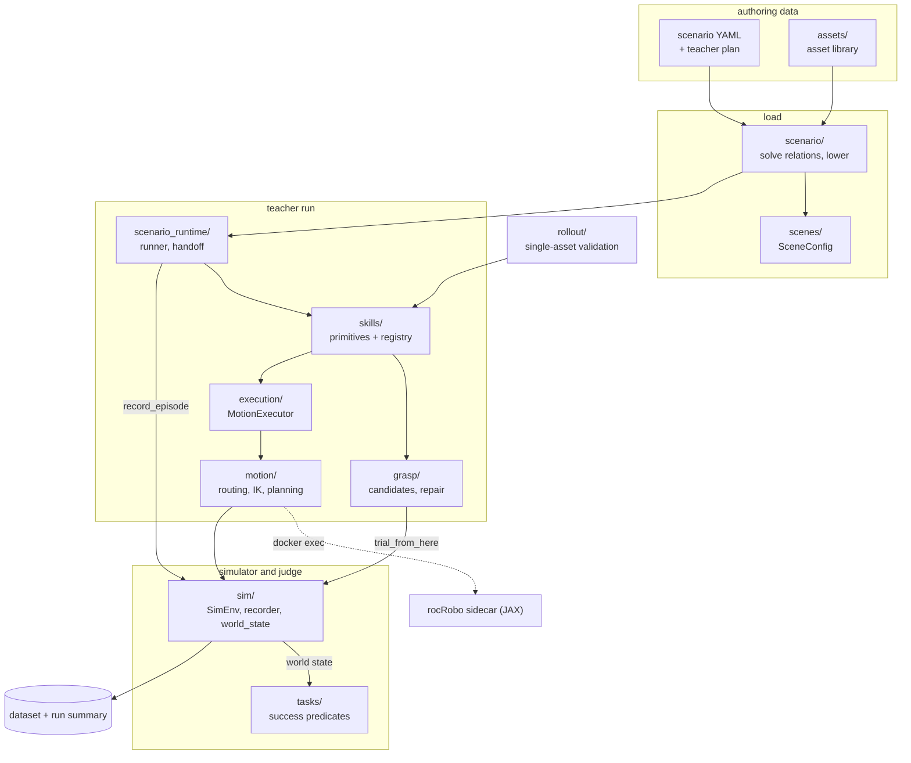
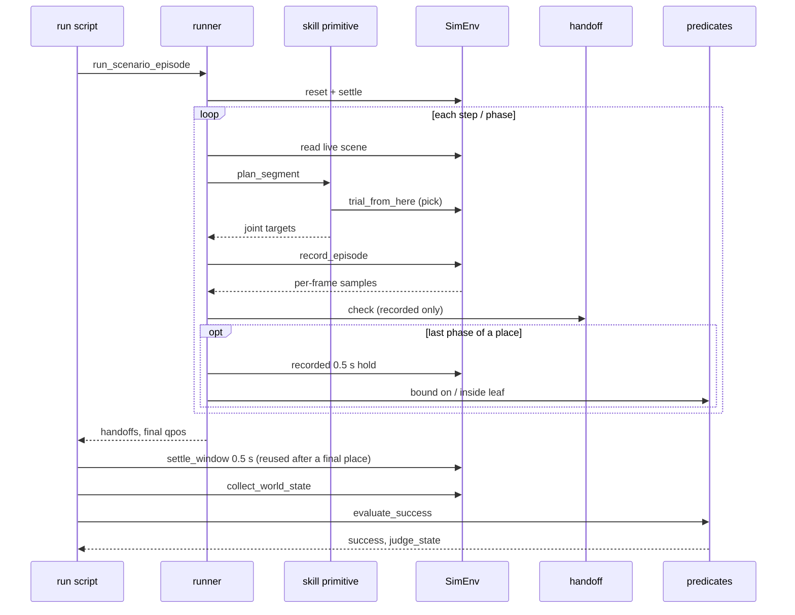
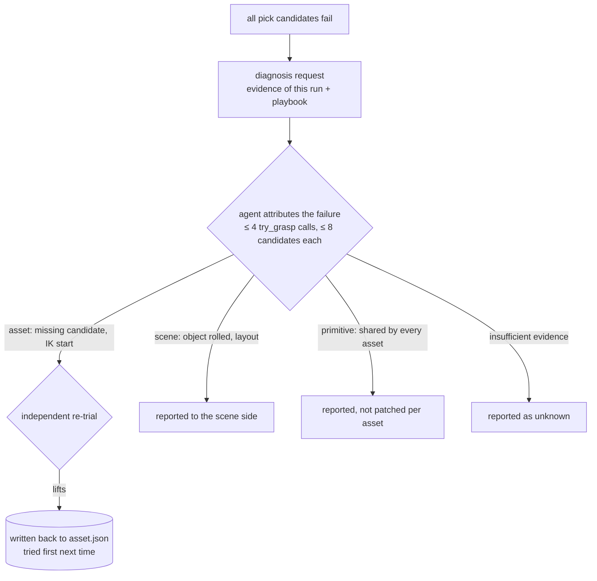

# RoboSmith design

> 中文版：[design-cn.md](design-cn.md).

RoboSmith turns **assets plus a declarative task** into **successful expert episodes recorded as a LeRobot
dataset**. You write *what* should happen; RoboSmith decides *how*: it builds the scene, plans a grasp for every
episode, generates a joint trajectory, rolls it out in Genesis, and keeps the success verdict next to the data.

It is data infrastructure, not a policy-training framework. The one training entry, `scripts/train_smolvla.py`,
consumes the dataset RoboSmith writes.

## Teacher and student

- **The teacher** is RoboSmith's scripted expert. It reads simulator ground truth: object poses and collision boxes
  from Genesis, and asset geometry, joints and place targets from the build files. It executes a scripted plan of
  skills and records the episodes that succeed. It does not use cameras or a learned grasp model; grasps are geometric
  candidates chosen by trial in simulation.
- **The student** is a policy trained on those episodes from what a real robot would see: camera images and its own
  state, the `observation.*` fields of the dataset. RoboSmith only produces its data; `scripts/train_smolvla.py` is
  the training entry.

Everything below the scenario layer serves the teacher: making its episodes succeed, and judging success from the
simulator rather than trusting the plan.

## Data flow

Each arrow is one typed contract, and each layer has one owner in the code:

| Contract | Type / module |
|---|---|
| Asset → library | `asset.json` + `checks.jsonl`, admitted on a passing review (`robotsmith/assets/store.py`) |
| Asset → scene | `AssetMetadata` (`robotsmith/assets/`) |
| Scenario → runtime | `robotsmith/scenario/load.py`, `robotsmith/scenario/adapters.py` |
| Grasp → execution | `GraspPlan`, including its waypoints |
| Repair → asset | `grasp_candidates` annotation + `trial_grasp` check (`robotsmith/grasp/annotations.py`, `grasp/diagnostics/`) |
| Execution → motion backend | the `MotionPlanner` protocol (`robotsmith/motion/`) |
| Simulator → judge | `collect_world_state` / `settle_window` (`robotsmith/sim/world_state.py`) |
| Simulator / recorder | `robotsmith/sim/sim_env.py`, `robotsmith/sim/recorder.py` (the only adapters) |

## Modules

Main call direction during a scenario run (lazy imports go both ways and are not drawn):

| Package | Owns | Main entry points |
|---|---|---|
| `assets/` | the asset library: load, derive geometry from build files, admit, deduplicate, fetch / publish builds; `producers/` generates new assets | `AssetLibrary`, `AssetMetadata`, `derive.py`, `store.draft_reasons`, `dedup.check`, `review/` |
| `scenario/` | scenario YAML: schema, per-seed relation solver, success tree, teacher plan; lowering to the runtime | `load.load_scenario`, `relations.solve`, `specs` (`SceneSpec`, `TaskSpec`, `SuccessSpec`), `intents.SkillIntentSpec`, `adapters` |
| `scenes/` | scene configuration and loading into Genesis | `SceneConfig`, `ObjectPlacement`, `genesis_loader` |
| `scenario_runtime/` | one scenario run: materialize the runtime package, drive the episode, per-step handoff checks | `materialize_candidate`, `runner.run_scenario_episode`, `runner.evaluate_scenario_task`, `handoff.check` |
| `skills/` | the skill primitives, their completion conditions and the registry; turn one step into joint targets from the live scene | `@register`, `SKILL_DEFS`, `plan_segment`, `skill_phases`, `Skill`, `SkillContext`, `frames.resolve_frame` |
| `grasp/` | grasp and place plans; geometric candidates; grasps written back to assets; repair-loop tools | `GraspPlan`, `GeometricGraspPlanner`, `annotations`, `diagnostics/` (`request`, `tool`, `writeback`, `playbook.md`) |
| `execution/` | compile a plan into a motion chain and a joint trajectory | `MotionExecutor` |
| `motion/` | segment routing, IK and collision-aware planning, the collision world | `chain.execute_motion_chain`, `MotionPlanner`, `GenesisBackend`, `RocRoboBackend`, `rocrobo_world` |
| `sim/` | the Genesis environment, Franka constants, the LeRobot recorder, and what judges read | `SimEnv` (`reset`, `trial_from_here`), `record_episode`, `collect_world_state`, `settle_window` |
| `tasks/` | the runtime task and the success predicates | `TaskSpec`, `SuccessNode`, `PREDICATE_REGISTRY`, `object_in_box`, `grasped`, `evaluate_success`, `JudgeInputError` |
| `rollout/` | single-asset pick validation (and its diagnosis requests), episode layout, video export | `asset_pick_validation`, `video_export` |

Scripts: `scripts/datagen/run_generated_scenario.py` runs a scenario; `scripts/datagen/validate_asset_picks.py`
validates picks per asset (`--diagnose-dir` writes repair requests); `scripts/assets/list_assets.py` is the catalog;
`scripts/train_smolvla.py` trains the student.

## Assets

An asset is a directory `assets/<id>/` (`model.urdf`, `visual.*`, `collision.obj`, `provenance.json`,
`asset.json`, `checks.jsonl`); `asset.json` names its `kind` and `category`, and the id carries no scene name, so one
asset can appear in any scene. A recorded room is a layout `scenes/<name>.yaml` that lists asset ids and their
poses; scenarios name it instead of copying it. New assets come from the
producers in `robotsmith/assets/producers/`: an LLM agent writing a Blender script for one object (`blender_item`,
the default), a snapshot of a reconstructed room (`aha3d_snapshot`), or an image-to-3D backend (TRELLIS.2 or
Hunyuan3D) followed by `mesh_to_urdf`. Producers write `assets/<id>/` as a draft; the backends import their model
repositories lazily and run in their own image, not in the Genesis one.

`asset.json` holds the `kind` (`rigid`, `articulated`, `fixture`), the source and build file lists with a hash of the
build files, the source's SPDX `license` and `attribution`, and annotations; each annotation records who wrote it (`human`, `harness`, `agent:<model>`,
`check:<name>@<version>`, or `legacy` for values migrated without a known writer). `checks.jsonl` is append-only: one
record per check run, bound to the asset revision and build hash. A record whose hash no longer matches the files does
not count. Mass, inertia and joint limits live only in the URDF. The loader assembles all of this into `AssetMetadata`.

What an asset can do follows from its annotations, not from its category:

| Asset kind | Unlocked by | Actions | Success predicates |
|---|---|---|---|
| rigid | an admitted graspable mesh | `pick`, `place` | `inside` / `on` (`object_in_box`), `lifted`, `stacked`, `aligned` |
| articulated | a movable URDF joint + `handles` | `open`, `close` | `joint_opened`, `joint_closed` |
| supporter / fixture | `kind: fixture` or any movable joint | none (it is a place target or an obstacle) | — |

- **Build files are the geometry.** The URDF and meshes are in metres with `+Z` up, so the asset frame is the
  upright object frame and the scene adds only a position and a yaw. Point clouds, grasp gates, and support
  clearances are all computed from the files as they are; there is no scale or upright annotation to apply.
- **Gate.** An asset is admitted when its current build has a passing `llm_review` record and its `source.license`
  may be redistributed (CC0-1.0, CC-BY-4.0, MIT, Apache-2.0, BSD-2/3-Clause), and it duplicates no admitted asset;
  otherwise it is a draft, and `store.draft_reasons` says which condition fails. Scenarios refuse drafts (`AssetNotAdmitted`), the asset package
  carries admitted assets only, and `scripts/assets/list_assets.py` shows each asset's status. The table under a
  scenario is a solid block sized by the scenario and the ground is Genesis' plane; neither is an asset.
- **Review.** `robotsmith/assets/review/` packs what the reviewer sees: the request stating the asset's use, renders
  in the simulator's frame, readings derived from the build files, and the URDF. The reviewer (an LLM) writes its own
  simulator probes, runs them, and returns a verdict; `admit` appends it to `checks.jsonl` as `llm_review`, bound to
  the revision and build hash it judged. Moving files does not admit anything.
- **Duplicates.** `admit` also runs `robotsmith.assets.dedup.check`, which records once per build, as a
  `dedup_check`, the admitted assets the new build may duplicate: the same build hash, or the same category, kind,
  movable joints and place targets with every edge within 20%. The same build hash refuses the asset outright; any
  other candidate needs a `dedup_review` verdict (`variant` or `duplicate`) from a reviewer who saw both, bound to
  both sides' revision and build hash. The gate reads only these records, so admission is the same on a fresh clone
  without build files; a candidate rebuilt or demoted after the check no longer counts. There is no embedding index.
- **Search.** `AssetLibrary.search_assets(query, category=, size_cm=)` returns admitted assets of a category,
  nearest size first, or those sharing a query word when no category is given; `list_assets.py --category --size
  --query` prints the same. An agent maps a request to a category from the catalog and searches before asking a
  producer for a new asset.
- **Package.** Build files are not in git; git tracks `asset.json`, `checks.jsonl` and source files. The build files
  of admitted assets live in a Hugging Face dataset (`lidavidsh/robosmith-assets`) at `<id>/<build_hash>/`, so a
  published path never changes and `asset.json` is the lock. `python -m robotsmith.assets.fetch` downloads files that
  are missing or do not match the hash and refuses a download that does not hash to the recorded value;
  `python -m robotsmith.assets.package publish` uploads new builds and regenerates the attribution table on the
  dataset card. Storage is addressed by build hash, not by scene or category, so reorganising the library never
  moves published files.

Geometry is derived from the URDF and meshes at load (`robotsmith/assets/derive.py`), not stored: `size_cm` is the
visual-geometry extent, the task joint is the movable joint, and a handle or place target only names a link or
collision box whose position the loader reads at zero joint configuration. Annotations keep only the semantic
choices: which link is the `handle`, which boxes are `place_targets` (with an optional insert `approach`).

## Scenario and teacher plan

A scenario is a YAML file: the scene as objects with relations (`on`, `near`, `clear_of`, `facing`, at most one
`anchor_xy` per fixture) and the task (instruction + success tree). It is data, validated against the JSON Schema in
`robotsmith/scenario/load.py`; nothing in it executes. Examples live in [`scenarios/`](../scenarios/); the authoring
contract for agents is [`scenarios/AGENT_PROMPT.md`](../scenarios/AGENT_PROMPT.md).

- **Relations are solved per seed** (`robotsmith/scenario/relations.py`) from asset geometry only: visual bounds,
  collision boxes, place targets and prismatic joints. `near: robot` samples the Franka workspace annulus, so one
  scenario is a distribution of layouts; `variations` swap fields per seed and `split` reserves seed ranges for
  playground and test.
- **The success tree** is `all_of` / `any_of` / `not` over relations such as `on`, `inside`, `lifted` and `joint`.
  It is lowered to registered predicates and judged as described under [Verification](#verification). It is
  meant to be hidden from the executor.
- **The teacher plan** (`scenarios/teacher/<name>.yaml`) is the ordered list of steps the teacher runs, for example
  `open: drawer`, `pick: die`, `place: {target: drawer.drawer_opening}`, `close: drawer`. It never writes waypoints,
  controls the gripper, or calls Genesis. Place targets on an articulated fixture follow the joint as it opens.

The scenario layer keeps its own `TaskSpec` (no actions, only the task) and lowers it to the runtime `TaskSpec`
(`tasks/task_spec.py`, success tree plus skills) in `scenario/adapters.py`; the two classes share a name but not a
role.

## Teacher execution

`scenario_runtime/runner.py::run_scenario_episode` drives one episode as a segment-level closed loop: every step
re-reads the live scene and plans only that step.

The skill primitive stands for `skills/`, `grasp/`, `execution/` and `motion/` together. `plan_segment` finds the step's primitive in `SKILL_DEFS` (`skills/registry.py`) and calls it with a
`SkillContext` (step, grasp planner, executor, motion planner, live scene, current joint target). Only `place` onto
an articulated target splits into `transport` and `descend`, so the descend re-reads the drawer after it recoils;
every other step is one phase.

### Grasp: geometric candidates, chosen by trial

Single-asset validation and scenario runs build candidates from the settled object's oriented box and `GripperSpec`
only (`grasp/geometric.py`), try them in simulation and keep the first one that lifts the object. Single-asset
validation tries each from the placed start state; a scenario tries each from the live scene (snapshot, replay,
restore: `SimEnv.trial_from_here`), so drawers already opened and objects already moved stay as they are. Grasps an
agent wrote back to the asset (`grasp_candidates`, see [Repair loop](#repair-loop)) are tried first.

There is no learned grasp model: the trial is the judge, so candidate quality only changes how many are tried;
geometric candidates fail in ways an agent can read (no candidate, too wide, IK branch jump) and are deterministic for
a reproducible bench; and the teacher already has privileged geometry, so it does not estimate grasps from images.

Two Panda facts shape the candidates:

- **The fingers close along the hand's local Y axis** (`panda_finger_joint*` `axis="0 1 0"`), so the hand rotation
  is `[finger × approach, finger, approach]`.
- **The finger pads reach 8 mm below the TCP** (`GripperSpec.pad_below_tcp`), so top-down TCP height is floored at
  object bottom + `pad_below_tcp` + `support_clearance` (10 mm). Without the floor, the pads of a 2.4 cm tall object
  end 4 mm above the table and, with about 3 mm of tracking sag, drag on it while closing.

Holding is still open. The fingers are position-controlled, and a closing target of 0.01 m per finger does not hold
a generated 0.22 kg stapler although both pads touch it; it lifts with `finger_closed=0.0`. A generated 0.38 kg tape
dispenser does not lift even at 0.0, with both pads on it.

### Motion: segment-level routing

Every skill compiles into a sequence of waypoints executed by `motion/chain.py::execute_motion_chain`. Each segment
is routed by what it is, not by which skill it belongs to:

| Segment | Route | Collision-aware |
|---|---|---|
| finger-only (close / open gripper) | arm locked, fingers move | — |
| contact (final approach, drag handle, descend, side insertion) | Cartesian straight line | no, by design |
| free (approach, lift, transport, retreat) | `plan_motion` when a collision world exists, otherwise IK + interpolation | yes, with rocRobo |

Contact segments are never motion-planned: near contact, a planner's detours are worse than a short controlled line.
A pick whose Cartesian segment jumps IK branches is rejected rather than executed.

### Motion backends and the collision world

`ROCROBO_BACKEND` selects the backend:

- **off** → `GenesisBackend`: IK only; `plan_motion` always fails, so free segments use interpolation.
- **on** → `RocRoboBackend`: collision-free IK and trajectory optimisation from
  [rocRobo](https://github.com/ZJLi2013/rocRobo) (JAX). JAX and PyTorch do not share a ROCm process well, so rocRobo
  runs in a sidecar container and RoboSmith talks to it over JSONL through `docker exec`.

With a collision-aware backend, `motion/rocrobo_world.py::build_obstacle_world` builds the world from live poses:
fixture collision boxes plus a ground half-space, with articulated parts placed at their current joint value
(prismatic joints only). During `place`, the held object is attached to the hand as a set of spheres, and the place
destination (the target box, and the moving link of an articulated target) is exempted. rocRobo plans the 7 arm
joints; the client adds the two finger joints back.

If `plan_motion` fails, the segment falls back to a straight line **without collision checks**; the log line
`straight-line fallback` marks it.

How rocRobo's IK trades pose against clearance matters for reading those failures. rocRobo builds IK on PyRoki's
least-squares problem: the end-effector pose is a soft cost (position weight 5, orientation weight 1), self-collision
is a cost with a 0.02 m margin, and each world obstacle is a constraint with a **0.05 m margin**
(`pipeline._ik_problem`). It solves from many seeds and keeps a solution within 1 cm of the target position, closest
to the previous configuration. `plan_motion` then judges the whole segment: the endpoint must be within 10 mm and 5°
of the target, the path within joint limits, and clearances above their thresholds. Two consequences:

- An `endpoint` miss only says that the segment's end failed that check, not why. Candidate causes include the world
  margin and a frame convention the two sides disagree on; the recorded lower_shelf misses have not separated them.
- `world_min_m` is the minimum clearance over the whole planned segment. A negative value says the segment touches an
  obstacle somewhere; it does not place that contact at the endpoint.

### Articulation

Articulated assets load as URDF joint bodies, reset to joint value 0 (or the scene's `joint_init`), and expose joint values in
`env_state.joint_positions`. `open` / `close` drag the handle along the joint axis ("open" means the joint value
increases) by the URDF joint travel. Long-horizon tasks such as `open → pick → place → close` re-anchor
every segment on the live simulation through `skills/frames.py::resolve_frame`, so a place target inside a drawer
moves with the drawer.

## Verification

Three checks read the simulator; none trusts the plan.

1. **Scene check (before the first step).** `SimEnv.reset` places objects, settles them and raises `SceneInvalid`
   if an object moved more than 5 cm, dropped more than 5 cm or tipped more than 30°. An invalid scene is not
   attempted or diagnosed.
2. **Step completion (after each step).** Every teacher step is judged by the condition bound to it at load
   (`scenario/adapters.py::to_step_bindings`), through the same predicates as the task (`SkillDef.post`,
   `runner._judge_completion`). The verdict, its binding and the judged state stay on the step, so it re-judges
   offline like the task.
   - `pick` → `grasped`: two different finger links touch the target and it rose at least 2 cm from the step's own
     start (read before the step was planned or trialled), at the end of the action, with no hold.
   - `place` → the success tree's `on` / `inside` relation for the object the preceding pick took, after a 0.5 s
     hold that is recorded into the episode; the `transport` phase of a two-phase place is not judged.
   - `open` / `close` → `joint_opened` / `joint_closed` on the joint the executor drags
     (`skills/frames.py::resolve_drag_joint`), past its endpoint − 2 cm (the upper limit or `distance`) or below its
     lower limit + 2 cm, at the end of the drag, with no hold.
   - An unchecked binding (`any_of` / `not` trees, an object placed twice, several candidate relations) records why
     and claims nothing.

   The per-frame samples of `scenario_runtime/handoff.py::check` are diagnostics only: distance and lift for a
   pick, joint travel for open / close, and for a place the frame the object left the hand, the joint jump before
   it and a candidate cause (`motion?`, `grip?`, `release?`). A failed episode reports its first unfinished step as
   `failed_step`, or `unknown` when every step passed, plus the success-tree leaves that failed. Steps do not decide
   episode success.
3. **Task success (after the last step).** `runner.evaluate_scenario_task` holds the arm at its last command for
   0.5 s (`sim/world_state.py::settle_window`, the only judging code that steps the simulator; when the last step
   is a place, its recorded hold is reused instead of a second one), reads one step with
   `collect_world_state` (positions, poses, world collision AABBs, entity-level contacts, the finger links touching
   each entity, joints), and evaluates the
   success tree with `tasks/predicates.py::evaluate_success`:
   - `on` / `inside` (`object_in_box`): the object's AABB against the place target's collision box (riding its
     joint) — centre over the box for `on`, whole footprint over the container floor for `inside`, bottom within 2 cm
     of the box top — plus contact with the target's asset, no contact with the robot, and every settle-window frame
     within 5 mm / 5° of the last. Orientation does not count, so a block standing on its end is on the shelf; a task
     that needs the object upright states that separately.
   - `lifted`, `joint` (opened / closed), `stacked`, `aligned` read positions and joint values.
   - A missing or non-finite observation raises `JudgeInputError` instead of reading as false.
   - The run summary keeps the evaluated tree (`success_tree`) and each episode's judged state (`judge_state`), so a
     verdict re-judges offline to the same result.

Known approximations: contacts are entity-level (touching a cabinet's side wall counts as touching the cabinet);
`inside` does not check the container's upper bound; the parent's yaw is the load-time value; `grasped` holds at
the end of the pick and says nothing about the object staying in the hand during transport.

### Repair loop

When every pick candidate fails, the diagnosis tools let an agent fix what candidates cannot:

Experience is stored in three places, each only after it was verified:

| | Per-asset grasps | Diagnosis experience | Primitive fixes |
|---|---|---|---|
| Content | repaired candidate poses, IK starts | failure signature → direction → owner | gripper, control or candidate rules |
| Stored in | `asset.json` `grasp_candidates` + `checks.jsonl` `trial_grasp` | `grasp/diagnostics/playbook.md` | product code |
| Verified by | an independent re-trial that lifts | the agent attributes known samples correctly | existing regressions + a new asset |
| Invalidated when | the asset is rebuilt, its revision changes, or the robot changes | the primitive fix lands | — |

The agent may propose candidate poses and IK starts, request asset corrections, and flag scene problems. It may not
change the gripper spec, control parameters or candidate rules, or set control parameters per asset. Asset fixes that
change build files (mass, collision, orientation) go through a rebuild and a new review. `validate_asset_picks.py
--diagnose-dir` writes the requests; calling the agent is the caller's job.

## Rollout and data

Per episode: reset objects to their resolved positions, settle for `settle_steps` (30), record the settled poses as
the initial state, run the steps, then judge the task. The run writes:

- a LeRobot dataset with the `up` camera; articulated joint values are appended to `observation.environment_state`;
- per-episode videos and `scenario_run_summary.json` (success, `judge_state`, handoffs, `failed_step` and
  `failed_leaves` per episode; `success_tree` and `step_bindings`; diagnostics and skill traces).

## Current limits

- **Collision awareness covers free segments only.** Contact segments are straight lines, and a failed plan falls back
  to an unchecked straight line. The rocRobo service can fail on some requests (it does on the drawer place), which
  silently produces that fallback. Most fallbacks are `endpoint` misses at pick waypoints. Seeding the endpoint IK
  with a converged solution does not clear them. Three recorded lower_shelf misses were replayed. In the IK candidate
  pools, before selection, no candidate was within 10 mm and 5° of the endpoint, so the miss is not a selection
  problem. Replaying each whole segment, it ended about 65 mm from the target position with about 2° of orientation
  error. This does not show that the pose is geometrically unreachable, and the cause is not yet identified.
- Articulation supports prismatic joints only; revolute open / close, push / press, and bimanual tasks are not
  implemented.
- Holding is position-controlled; heavier objects slip (see [Grasp](#grasp-geometric-candidates-chosen-by-trial)).
- Flat, wide objects (a phone lying down) have no candidate family; the repair loop reports them as unknown.
- Generated assets can use an open visual mesh as their collision body, so objects roll off at reset; the scene
  check rejects them, and the fix is on the asset side.
- In `pick_one_of_three` the snapshot trial and the execution disagree once; the cause is not known.
- One asset per process: `SimEnv.build` initialises Genesis every time, so a second build in the same process fails.
- The first `plan_motion` of a new scene shape compiles for about 10 minutes; later runs reuse the JAX disk cache.
- Data comes from scripted IK replay only; there is no DAgger-style or closed-loop evaluation backend yet.

## Built on

- [Genesis](https://github.com/Genesis-Embodied-AI/Genesis): GPU physics simulation.
- [LeRobot](https://github.com/huggingface/lerobot): dataset format and the SmolVLA training entry.
- [rocRobo](https://github.com/ZJLi2013/rocRobo) on [PyRoki](https://github.com/chungmin99/pyroki): collision-free IK
  and trajectory optimisation.
- [Objaverse](https://objaverse.allenai.org/) and [Articraft](https://github.com/mattzh72/articraft): asset sources.
- [Blender](https://www.blender.org/): LLM agents build single-object assets as Blender scripts.
- [Hugging Face Hub](https://huggingface.co/docs/hub/datasets): the dataset that stores build files by hash.
- [TRELLIS.2](https://github.com/microsoft/TRELLIS.2) and [Hunyuan3D-2.1](https://github.com/Tencent-Hunyuan/Hunyuan3D-2.1):
  image-to-3D backends for generated assets.
