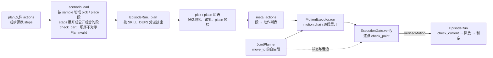

# 操作：基本 agentic 操作证明任务可解

总体设计见 [system-design](system-design.md)，函数级的调用链见 [call-chain](call-chain.md)，验收场景与 plan 文件格式见
[acceptance](acceptance.md)。

## 要保证什么

agent 写步骤表（pick X、place X on Y…）或 plan 文件给出动作组合，技能执行，每步判定。**任务判定成立，且实际执行的每个动作都事先在
仿真几何里验证过，才算证明可解。** 不可行就带原因失败，不靠物理推挤蒙混。同一套操作也是第一个被测方（基线）。

- 步骤层：agent 写步骤表，失败按计划层 / 物理层分流，同一 episode 内重新规划。
- 抓取：由物体几何生成候选，在仿真里试抓、按结果选；全部失败时 agent 修复环归因、补候选、复核后写回资产。
- 放置：在资产标注的目标面上放；抽屉开合。
- 判定：每步与整个任务共用同一组谓词，读仿真状态，可离线复判。
- 执行：技能、试抓、单资产验证只执行过了[执行门](#执行门的接口与契约)的轨迹；开合抽屉标 `ungated`。

## 设计一览

**技能是六个 meta action 的组合。** plan 文件的 `actions` 写出组合，运行时按它生成运动：自由段由 RRT-Connect 在仿真几何里搜出，
接触附近走笛卡尔直线，整条稠密轨迹逐点过同一道执行门，拿到门签发的凭证才走物理步。合法性只有门一个 owner，规划器搜索时问的也是它。
分工对照 MoveIt Task Constructor 的 Generate（`sample`）/ Connect（`move_to`）/ MoveRelative（`move_linear`）/
ModifyPlanningScene（`attach` / `detach`）。



- **一个入口。** episode、certify 与单资产验证都经 `EpisodeRun`；技能分派只在 `EpisodeRun._plan`。
- **组合直接执行。** 每个 pick / place 技能带着 plan 里属于自己的那段（`Skill.params["actions"]`），`meta_actions` 逐项翻译；
  段里的参数（如抬升的方向与距离）就是机器人做的。只有 `steps` 时展开成公开组合的同一段。
- **预测与实测分开。** 规划时持物状态是一份 `PlanState` 上的预测；pick 执行之后，place 从实测的关节与手—物变换重新规划、重新过门。
- **零步拒绝。** 门拒绝、规划无解都发生在第一个物理步之前，结果带标签与逐候选证据，场景不变。

## 六个 meta action 与 pick / place 组合

| 动作 | 运动由谁生成 | 状态变化 |
|---|---|---|
| `sample` | `GraspPlanner.plan`（抓取）/ `plan_place`（放置），几何采样 + IK，零运动 | 绑定一组候选；grasp 给 `pre` / `grasp` 位姿，place 给 `pre` / `place` / `retreat` |
| `move_to` | `JointPlanner.connect`，关节空间 RRT-Connect | 到目标构型，持物不变 |
| `move_linear` | `motion.move_linear.expand`，笛卡尔直线逐点 IK | 末端沿直线到达，持物不变 |
| `gripper` | `motion.gripper.expand`：臂锁定，指关节取该位姿 IK 解的指关节 | 开到全宽或合到被物体挡住 |
| `attach` | `PlanState` 事件，零运动 | 持物 = 刚体，`T_hand_object` 取自抓取绑定 |
| `detach` | `PlanState` 事件，零运动 | 持物为空，物体留在放置位姿 |

参数写法见[六动作 schema](acceptance.md#plan-文件的-actions六动作组合)。本版只接受一种组合顺序，可变的是物体、放置面与直线抬升的向量：

```text
pick:  sample(grasp) · gripper(open) · move_to(g.pre) · move_linear(g.grasp) · gripper(close, target) · attach(g) · move_linear({direction, dist})
place: sample(place | g) · move_to(p.pre) · move_linear(p.place) · detach(p) · gripper(open, target) · move_linear(p.retreat)
```

公开组合的抬升是世界 +Z 0.10 m。`execution/meta_actions.py` 的 `check_part` 在加载时确认段内顺序，`pick_actions` / `place_actions`
把段译成动作列表：运动段是 `RuntimeMotionWaypoint`（`finger_only` 即 `gripper`，`linear` 即 `move_linear`，其余是 `move_to`），
持物变化是 `Attach` / `Detach` 项。`MotionExecutor.run` 是动作列表进运动链的唯一入口。

每段带门用的 span 与接触许可：

| 段 | 持物 | 许可 |
|---|---|---|
| pick 张指（起点已张开则 0 帧）、进场、下探 | 否 | 无；下探遇 IK 跳变即拒 |
| pick 合指（含 settle） | 否 | `grip`：手指可碰目标 |
| pick 抬升（`Attach` 之后，含保持） | 是 | `rest`：被抓物可离开起始支撑 |
| place 搬运 | 是 | 无 |
| place 下放 | 是 | `rest`：被抓物可碰放置目标 |
| place 松指、退回（`Detach` 之后） | 否 | `grip`；物体按 detach 时的位置检查 |

持物只经 `attach(state, Holding)` / `detach(state)` 改变，二者保持关节、不加轨迹点、不步进；已持物再 attach、空手 detach 都报错。
一个组合至多一次 attach → detach。

## 一个 pick / place 怎么执行

**pick**（`skills/pick.py`）按候选顺序（写回资产的抓法在前，再按有向包围盒枚举 top_down / side）对每个候选：

1. 在当前构型张指；IK 解 pre-grasp（初值为 home 构型、基座关节转向抓取方位，或候选的 `ik_seed`）。
2. 从 pre-grasp 起的 pick 列表先单独过门，被拒的候选不花规划。
3. `JointPlanner.connect` 从张指后的构型连到 pre-grasp，得到进场段；整张 pick 列表（进场是带路径的 `move_to` 项）过门。
4. 下一步是静态锚点上的单阶段 place 时，在 `SimEnv.posed(pick 末点, 目标在手中)` 里以复制的 `SkillContext` 调 place 原语预检，
   凭证与 trace 丢弃；place 被拒的候选不试抓。
5. `SimEnv.trial_from_here` 试抓（重放、恢复快照，抬高超过 0.02 m 算抬起），抬起后在恢复的状态上对同一条轨迹再过门，签发凭证。

第一个通过的候选被选中；`trial_all`（修复工具用）试遍全部候选，最后按顺序对抬起者重新过门。没有候选在任何试抓之前过门时抛
`Refused("search_exhausted")`（零物理步）；已有候选试抓过、却没有一个成立时抛 `ExecutionFailed(evidence, steps)`。

**place**（`skills/place.py`）从实测状态开始：`plan_place` 给出落点（目标点 + 抓取相对高度），IK 解 standoff（手指取当前值），
`JointPlanner.connect` 带持物规划搬运，`place_actions(phase="descend")` 接下放、`Detach`、松指、退回，整条一次 `verify`、一张凭证。
任一步被拒都是零步 `Refused("search_exhausted")`，证据带 connect 或门的原因。动态锚点的 place 分 transport / descend 两段，
descend 前重读目标位置；这种 place 不在 pick 里预检。

pick 已走过物理步之后组合即提交：place 被拒时 `EpisodeRun` 记 `execution_failed`，`evidence.refused` 保留原标签。
`EpisodeRun` 把停下的原因记进 `stopped`（`cause`、`evidence`、`steps`），不做正式回放，停在这一步。

## 执行门的接口与契约

门在 `robotsmith/execution/gate.py`。每个概念一个 owner：

| 概念 | Owner |
|---|---|
| Genesis 场景状态：快照、构型、状态指纹 | `SimEnv` |
| 「这条轨迹能不能执行」、持物生命周期与接触许可规则 | `ExecutionGate`（许可规则只在 `permitted` 一处；读实际物理接触的验收用同模块的 `certified`，见 [certified 读数](acceptance.md#被测链路的-certified-读数)） |
| 候选及其顺序（抓取）、place 的搬运目标 | 技能层（`run_pick` / `run_place`） |
| plan 文件的 `actions` 切成 pick / place 段；只有 `steps` 时展开成公开组合的段 | `scenario.load`（`actions_to_intents`；`pick_part` / `place_part`） |
| 把一段逐项译成动作列表：段的顺序、允许接触与 `Attach` / `Detach` 的位置 | `execution.meta_actions`（`check_part` / `pick_actions` / `place_actions`） |
| 动作列表进运动链的入口 | `MotionExecutor.run`（拖拽的段也经它） |
| 自由段 | `motion.joint_planner.JointPlanner` |
| 规划中的预测构型与持物绑定 | `motion.plan_state.PlanState`（只经 `attach` / `detach` 改变持物） |
| 关键位姿到稠密关节路径与段边界 | `motion.chain.execute_motion_chain` |
| 笛卡尔直线段的关节路径 | `motion.move_linear.expand` |
| 开合指段的目标构型 | `motion.gripper.expand` |
| 抓取的物理是否成立（抬得起） | `SimEnv.trial_from_here`，只在过门之后调用 |
| 技能分派与执行 | `EpisodeRun`，只回放验证过的轨迹，不解 IK |

接口：

- `ExecutionGate.check_point(q, span, *, target, rest=(), held=None, placed=None, pose=None)` 是唯一的单点合法性检查，
  合法返回 `None`，否则返回 `{"reason", 证据}`：`invalid_value`（非有限值或维数不对）、`joint_limit`（超出
  `SimEnv.joint_limits`）、`fk_residual`（带 `pose` 时手部位姿与它相差超过 5 mm / 0.05 rad）、`self_collision`
  （机器人两连杆相碰且不在 `SimEnv.joined_links`，即非父子、非同父）、`collision`（其余接触不被 `permitted` 许可）。
  只读，返回或抛出时场景不变。规划器与 `verify` 用同一个它。
- `ExecutionGate.verify(trajectory, spans, *, target, q_start, rest=(), holding=None, poses=None, budget=None)` 对每个点调
  `check_point`，第一个不过的点抛 `MotionRejected(span, index, rejection)`（`rejection` 即上面的字典，接触对在 `.pair`）。
  `spans` 是 `Span(label, start, end, holding, allow)`，必须无缝铺满整条轨迹，门检查的是**会被执行的每一个稠密轨迹点**，
  不抽样；性能优化不得减少被检查的点。`poses` 是 `{轨迹下标: (pos, quat)}`，只含要到达某个手部位姿的点：运动链给每段记下
  航点位姿 `pose` 与到达它的下标 `reach`，`gate.poses_of(segments, offset)` 换算出来；自由插值的中间点、规划路径与保持点
  不带期望位姿，所以不会因偏离终点被拒。`ungated(trajectory)` 只给开合抽屉用。
- 通过时返回只读的 `VerifiedMotion(trajectory, spans, fingerprint, checked, gated, holding)`；只有签发它的门的
  `check_current` 接受它，手工构造或别的门签发的凭证一律 `StaleMotion`。
- 凭证内容不可改：`VerifiedMotion` 与 `Holding` 只持有轨迹点和持物变换的 float64 `bytes` 副本与 shape，
  `trajectory` / `t_hand_object` 每次读取都从 `bytes` 构造新的视图。底层是只读缓冲区的数组不能用 `setflags(write=True)`
  重开写入（[NumPy `setflags`](https://numpy.org/doc/stable/reference/generated/numpy.ndarray.setflags.html)：只有自有内存
  或最终 owner 暴露可写缓冲区时才允许），视图、切片、memoryview 同样被拒；改读到数组的 `dtype` / `shape`
  （NumPy 2.5 起已弃用）只改调用方手里那份，下一次读取与回放仍是验证时的数值。调用方保留的输入数组与凭证不共享内存。
  另一种做法是签发时记内容哈希、`check_current` 时比对，它只能在执行前发现改动；不可变存储让改动无从发生，所以选它。
  限制：对 frozen dataclass 调 `object.__setattr__`、经 ctypes 按裸指针写内存能绕过 Python 层的保证，门不防这类刻意绕过。
- 段边界来自运动链：每段带 `span` / `holding` / `allow`，段后保持计入所在段；pick 的进场段是列表里带路径的 `move_to` 项，
  place 的搬运段由技能层作为第一段加入。
- `SimEnv.contacts_at(qpos, held=None, placed=None)`、`SimEnv.hand_pose(qpos)`、`SimEnv.object_pose(name)` 在一个快照事务里
  摆构型（`held=(name, T)` 把物体放在手 · T，`placed=(name, T_world)` 放在世界位姿）、跑碰撞检测或正运动学，返回前还原快照。
  `SimEnv.state_fingerprint()` 是真实写入代次与全部刚体关节位置、速度的哈希：代次由 `SimEnv.step()`、`SimEnv.reset()` 与
  `SimEnv.hold()` 递增，录制与 settle 窗口都经 `SimEnv.step()` 步进；快照事务内的还原不递增，所以同值 reset 也会让旧验证失效。

契约：

- **持物生命周期**：持物是调用方给的 `Holding(target, t_hand_object)`，有持物段而没有它时 `verify` 报错。T 都由
  `plan_state.binding(target, hand_pose, object_pose)` 算：pick 传抓取候选的手部位姿（预测），place 传实测手部位姿。attach 处（首个持物点的前一点；轨迹从持物开始时取
  `q_start`）手 · T 与被抓物位姿相差超过 5 mm / 0.05 rad 时拒绝，记 `binding_mismatch`。持物段被抓物位姿 = 手位姿 · T；
  最后一个持物点之后，被抓物留在 手(最后持物点) · T，退回时手掌穿过它会被拒绝。被抓物就是场景里那个 entity，几何与执行一致。
- **接触许可**：
  - 手指碰目标，只在持物段或 `grip` 段合法；手的其它 link 碰到目标一律违规。
  - 被抓物碰支撑面或放置目标的 entity（`mat.top` 取 `mat`），只在 `rest` 段合法。
  - 其余凡涉及机器人或被抓物的接触都违规。
  - 相连（父子、同父）连杆的接触不判。
  - 必须拒绝的样例：两个端点合法、但中途穿墙的轨迹。
- **步骤级结果**：`Refused(label, evidence)` 只接受 `search_exhausted`（声明的候选与预算内没有过门的运动，不证明不可解）、
  `unsupported`、`infeasible` 三个标签，都是零物理步；`infeasible` 留给覆盖动作域的可检查证明，现在没有任何路径产出它。
  `ExecutionFailed(evidence, steps)` 表示已步进过物理，保留实际步数。
- **状态事务**：只有 `SimEnv` 写 Genesis 状态。快照事务不改变状态指纹；试抓会步进物理，所以试抓之后旧的验证一律作废。
- **失效与零执行**：执行前 `check_current` 比对 `VerifiedMotion.fingerprint` 与当前指纹，不等就抛 `StaleMotion`。
  `verify` 抛出时没有任何一点进入录制。settle 与保持只下发最后一个已验证点。初始 reset / settle 属于场景初始化，不在门的范围。
- **并发**：不支持。一个 `SimEnv` 同一时刻只能有一个调用者。

## 自由段规划器 JointPlanner

`robotsmith/motion/joint_planner.py` 的 `JointPlanner(env, gate, *, seed=0).connect(q_start, q_goal, *, target, rest=(),
holding=None, label="move_to")` 是仓库内的 lazy RRT-Connect（双树、固定种子），依赖只有 numpy。pick 用它规划进场，place 用它规划搬运。

- 合法性只问 `gate.check_point`，持物带调用方的 `Holding`；路径由 `gate.verify` 签发，返回
  `Connection(motion, queries, seconds, nodes, direct)`。查询与失败都零物理步、不改状态。
- 连边细分：`SimEnv.lever_arms(held)` 给每个关节的力臂上界 r（从关节锚点沿连杆原点到它带动的任一连杆碰撞 AABB、
  手指行程、持物 AABB 的最远距离），每步 Σ r_k |Δq_k| ≤ 5 mm，所以任一连杆或持物上的点每步位移不超过 5 mm。
  边内的点按二分顺序检查，碰撞早遇早停。
- 先试直连；不通则双树生长，新节点只查状态。两树相遇后从每个节点直接连到能连通的最远后继（捷径），树边失败就剪掉
  它下面的子树再长。
- 预算：每次 connect 至多 1500 次状态查询或 30 s，覆盖搜索与最终 `verify` 的逐点签发；`verify(..., budget=)` 在每点
  检查前扣一次查询、检查后与返回凭证前核对截止时间。返回的 `queries` 就是门实际检查的点数。用尽或超时即
  `Refused("search_exhausted", {"reason": "budget", "queries", "seconds"})`，不签发；起止点非法为 `invalid_start` / `invalid_goal`，
  带门的拒绝原因。做法同 MoveIt：`allowed_planning_time` 是规划与路径简化的总预算（MoveIt 2 OMPL 接口
  [`model_based_planning_context.cpp`](https://github.com/moveit/moveit2/blob/main/moveit_planners/ompl/ompl_interface/src/model_based_planning_context.cpp)
  以 `allowed_planning_time - ptime` 调 `simplifySolution`）；本项目的签发就是对插值后路径的逐点重验，所以也算在内。
  截止检查都在查询之间：正在运行的单点查询打断不了，仿真挂住由 `batch.supervise` 在进程外强杀并记 `error`。
- 起态装配：`SimEnv.hold(qpos, name, T)` 把机器人放到 qpos、物体放到手 · T，算一次真实写入，不步进。

F2 布局的固定持物请求（retreat 位姿 → mat 正上方同高）在 Genesis 上一次连通：直连以左手指碰 barrier 被拒，
connect 全程 548 次查询、10.9 s，签发 247 点，最大每步位移 4.995 mm（[e3](../exps/r1/evidence/e3/README.md)、
[e4](../exps/r1/evidence/e4/README.md)）。

限制：均匀采样的 7 维路径会绕远，CPU 受控样例里绕一道 0.2 rad 宽的墙要 0.6k–4k 次查询；比扩展步长（0.1 rad）还薄的
障碍会让两树隔着它反复相遇、剪枝，同类薄墙要 7k–160k 次，超出预算。OMPL 算法更成熟，但 Python 绑定未在 ROCm 镜像上
验证，接口留在 `JointPlanner` 可换；VAMP、cuRobo 自带碰撞表示，会形成与仿真几何不一致的第二份世界，不选。

## 机器人控制与回放

`scenes/genesis_loader` 加载 Franka 时给 `gs.materials.Rigid(gravity_compensation=1.0)`，与真实 Franka 力矩控制器的重力补偿
一致。Genesis 的前向动力学按实体把重力乘以 `1 − gravity_compensation`，只作用于机器人连杆，持物与其它物体照受重力。
不开补偿时关节 PD 靠位置误差扛重力，静止构型低于命令构型（按模型估计 6–16 mm，主要在关节 2–4），门检查的命令构型与回放的
实际构型对不上，贴着 barrier 的路径在回放中碰上它（F2 7/10，见[结果](#结果)）。

回放（`sim/recorder.record_episode`）逐点下发 `VerifiedMotion.trajectory`，每点一步物理，不确认到位。门只判接触、不留间隙；
门与执行之间没有偏差界，动态跟踪滞后（KV / KP = 0.1 s）未被约束。

## 结果

模板链路（写死的航点、转基座的固定 transit 搬运）的 test 读数是 F0 19/20、F1 19/20、F2 0/20，F2 全部卡在写死的搬运路线
（[读数](acceptance.md#被测链路的-certified-读数)）。之后逐片替换，每片只改一件事，在 playground seed 0–9 上与上一片比：

| 片 | 改了什么 | F0 | F1 | F2 | 证据 |
|---|---|---|---|---|---|
| 基线 | 门加固（`check_point`、只读凭证、`Refused`、显式 `Holding`），链路未改 | 10/10 | 10/10 | 0/10 | [e6](../exps/r1/evidence/e6/README.md) |
| place 搬运走规划器 | 删转基座与搬运高度 | 10/10 | 10/10 | 7/10 | [e7](../exps/r1/evidence/e7/README.md) |
| pick 进场走规划器 | 删 `_pick_seed_transit` | 10/10 | 10/10 | 7/10 | [e9](../exps/r1/evidence/e9/README.md) |
| pick 先确认 place 可达 | 整组在第一个物理步前过门 | 10/10 | 10/10 | 7/10 | [e10](../exps/r1/evidence/e10/README.md) |
| `move_linear`、`gripper` 拆出 | 纯重构，送门轨迹逐项相同 | 10/10 | 10/10 | 7/10 | [e11](../exps/r1/evidence/e11/README.md)、[e12](../exps/r1/evidence/e12/README.md) |
| `PlanState` 持物 | 纯重构 | 10/10 | 10/10 | 7/10 | [e13](../exps/r1/evidence/e13/README.md) |
| 一个执行器跑动作列表 | 删 `MotionExecutor.pick / place` | 10/10 | 10/10 | 7/10 | [e14](../exps/r1/evidence/e14/README.md) |
| 公开动作语义 | 进场前张指、+Z 0.10 m 直线抬升、`detach` 先于松指 | 10/10 | 10/10 | 5/10 | [e15](../exps/r1/evidence/e15/README.md) |
| 重力补偿 | Franka `gravity_compensation=1.0` | 10/10 | 10/10 | 10/10 | [e19](../exps/r1/evidence/e19/README.md) |
| `actions` 直接执行 | 入口合一，删 `run_skills`、`plan_segment`、`LIFT` | 10/10 | 10/10 | 10/10 | [e16](../exps/r1/evidence/e16/README.md) |

- 重力补偿之前 F2 的 3–5 个失败都是任务成立、但回放中 `link5` 或 `hand` 实际碰到 barrier，门签发时判这些点合法。
- F4（罩住）到「pick 先确认 place 可达」为止每片都是 10/10 零步拒绝，之后不再测，负例零执行由 CPU 测试覆盖。
- `actions` 直接执行那一片上，同一份公开 plan 的 `steps` 与 `actions` 送门的轨迹与段完全相同，改段里的抬升距离就改变送门轨迹；
  die_01 单资产抓取 3/3。
- 单实例耗时从模板链路的约 50 s 涨到约 150–170 s：每次 connect 约 8–10 s，规划路径每 5 mm 一个物理步，
  place 在 standoff 处还有一段几乎不动的插值。

冻结实现后的最终读数（F0 / F1 / F2 与留出族的 test seed）还没有读，口径见[认证口径](acceptance.md#认证口径)。

## 已定 / 不做 / 限制

- rocRobo 与碰撞盲退回已删除，不保留为可选后端：它在自己的简化世界里规划，与仿真几何不一致，所测的一个可行位姿它也判失败，
  失败时退回不检查的直线、照常判成功。启动脚本随之不再挂 Docker socket。
- 中间层用 Python 自建，不接 MoveIt（ROS / C++，跑不到 Genesis 上）。
- 本版只服务 pick / place：不做动作注册表与扩展接口，不做 `push`、`articulate`；关节体操作（开合抽屉）沿用 `drag_handle`，
  不过门、标 `ungated`，验收族里没有抽屉。
- 不做组合内回溯与超出「抓法 × 放置」的组合搜索：pick 的候选循环加 place 预检就是全部搜索；多次 connect 之间不共享预算。
- 加载期只核对段内动作顺序与引用是否指向更早的 `sample`、位姿名是否合法；不核对 place 段的位姿引用是否属于 place 绑定、
  `gripper.target` 与 `place.object` 是否就是被操作的物体，执行时按段的默认候选执行。
- 门与执行之间没有偏差界（见[机器人控制与回放](#机器人控制与回放)）；门判的是命令构型。
- 抓取不用学习模型；夹爪为位置控制，约 0.2 kg 以上的物体会滑脱。

## 实现须知

- Genesis 里判某个构型有无接触，要在设定关节后直接跑碰撞检测，不能先走一步仿真（一步内求解器会把手推开，读成无接触）。
- Panda 手指沿 hand 局部 Y 闭合；夹爪可用开口至少 7.5 cm。
- 同一个末端位姿换 IK 初值，接触结果会变：验证过的关节构型要带到执行，执行时不再重新解 IK。
- 直线段的跳变策略写在航点的 `linear` 上：单步关节变化超过 0.8 rad 时，pick 的最终接近 `refuse`（抛 `RuntimeError`，
  该候选不过），抬升、下放、退回与拖拽 `keep`（路径照样送门）。
- `SimEnv.posed(qpos, objects)` 是不步进的摆放事务。Genesis 的 `scene.reset(scene.get_state())` 会丢掉上次 step 之后的
  `set_pos` / `set_dofs_position`，所以事务里每次查询的快照还原之后都重放摆放；事务期间指纹带事务序号，里面签发的凭证在事务外不当前。
- `SimEnv` 的三个查询已在 Genesis 0.4.5（MI300X、F1 场景）上实测，测试在 `tests/test_sim_queries_gpu.py`：
  - `set_dofs_position` 摆好构型后，`rigid_solver.detect_collision()` 直接反映新构型；交替查询相交 / 分离构型不沿用上一次结果。
    持物按 `set_pos` / `set_quat` 摆到手位姿 · T 后同样即时生效。
  - 快照事务 `scene.get_state()` / `scene.reset(state)` 还原后指纹不变，查询抛异常时也还原。
  - 单点耗时在 10 ms 量级，几百个稠密点的轨迹过一次门要几秒；不抽样。
- 执行门在同一环境的真实场景上满足所列预期，测试在 `tests/test_gate_gpu.py`：两端合法、中途碰墙的轨迹在中间点被拒；
  持物进墙以被抓物–墙被拒、越过墙上方可过门，手 · T 摆出的被抓物与预期位置相差不到 1 mm；松手后手掌下到被抓物处以
  机器人–被抓物被拒、向上退回可过门；真实步进后旧凭证失效。
- `check_point` 的关节限位、FK 残差、非邻接自碰撞与 attach 核对在 CPU 受控样例上验证过（[e1](../exps/r1/evidence/e1/README.md)）；
  IK 残差超过 5 mm 的抓取候选会以 `fk_residual` 或 `binding_mismatch` 被拒。
