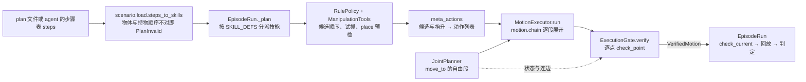

# 操作：规则化的抓放管线证明任务可解

总体设计见 [design](design.md)，函数级的调用链见 [call-chain](call-chain.md)，验收场景与 plan 文件格式见
[acceptance](acceptance.md)。

## 要保证什么

agent 写步骤表（pick X、place X on Y…）或 plan 文件给出动作组合，技能执行，每步判定。**任务判定成立，且实际执行的每个动作都事先在
仿真几何里验证过，才算证明可解。** 不可行就带原因失败，不靠物理推挤蒙混。同一套操作也是第一个被测方（基线）。

- 步骤层：plan 文件给出步骤；可选的 LLM 规划器（`scenario_runtime/planner.py`，certify 不用）写步骤表，失败按计划层 / 物理层分流，
  同一 episode 内重写剩余步骤。
- 抓取：由物体几何按规则生成候选，在仿真里试抓、按结果选。单资产验证全部失败时，离线修复环归因、补候选、复核后写回资产；
  scenario 与 certify 的 episode 里没有修复环。
- 放置：在资产标注的目标面上放，放置位姿按规则换算，只在竖直放置时把物体放对（见[货架](#货架抬高带挑檐的放置面与货架上起抓)）；抽屉开合。

抓法、接近与退出、放置位姿都是固定规则，episode 里没有 agent 选择或修正它们；这一层还不是 agentic manipulation
（[design](design.md#操作规则化的抓放管线证明任务可解)）。
- 判定：每步与整个任务共用同一组谓词，读仿真状态，可离线复判。
- 执行：技能、试抓、单资产验证只执行过了[执行门](#执行门的接口与契约)的轨迹；开合抽屉标 `ungated`。

## 设计一览

**技能是六个 meta action 的组合。** pick 与 place 各是一种固定组合，步骤只选物体、放置目标与 pick 的抬升；
运行时按组合生成运动：自由段由 RRT-Connect 在仿真几何里搜出，
接触附近走笛卡尔直线，整条稠密轨迹逐点过同一道执行门，拿到门签发的凭证才走物理步。合法性只有门一个 owner，规划器搜索时问的也是它。
分工对照 MoveIt Task Constructor 的 Generate（`sample`）/ Connect（`move_to`）/ MoveRelative（`move_linear`）/
ModifyPlanningScene（`attach` / `detach`）。



- **一个入口。** episode、certify 与单资产验证都经 `EpisodeRun`；技能分派只在 `EpisodeRun._plan`。
- **组合直接构造。** `meta_actions.pick_actions` / `place_actions` 按组合的固定顺序、对一个候选直接构造动作列表；
  pick 的抬升取步骤的 `lift`（`Skill.params["lift"]`），没写时是世界 +Z 0.10 m。
- **预测与实测分开。** 规划时持物状态是一份 `PlanState` 上的预测；pick 执行之后，place 从实测的关节与手—物变换重新规划、重新过门。
- **零步拒绝。** 门拒绝、规划无解都发生在第一个物理步之前，结果带标签与逐候选证据，场景不变。

## 六个 meta action 与 pick / place 组合

| 动作 | 运动由谁生成 | 状态变化 |
|---|---|---|
| `sample` | `GraspPlanner.plan`（抓取）/ `plan_place`（放置），几何采样 + IK，零运动 | 绑定一组候选；grasp 给 `pre` / `grasp` 位姿，place 给 `pre` / `place` / `retreat` |
| `move_to` | `JointPlanner.connect`，关节空间 RRT-Connect | 到目标构型，持物不变 |
| `move_linear` | `motion.move_linear.expand`，笛卡尔直线逐点 IK | 末端沿直线到达，持物不变 |
| `gripper` | `motion.gripper.expand`：臂锁定，指关节取该位姿 IK 解的指关节 | 开到全宽或合到被物体挡住 |
| `attach` | `PlanState` 事件，零运动 | 持物 = 刚体，`t_hand_object` 取自抓取绑定 |
| `detach` | `PlanState` 事件，零运动 | 持物为空，物体留在放置位姿 |

写法与示例见 [plan 文件用法](../scenarios/AGENT_PROMPT.md#plan-file-optional)。组合只有一种顺序，步骤能选的是物体、放置目标与
pick 抬升的方向和距离：

```text
pick:  sample(grasp) · gripper(open) · move_to(pre) · move_linear(grasp) · gripper(close) · attach · move_linear(lift)
place: sample(place) · move_to(pre) · move_linear(place) · detach · gripper(open) · move_linear(retreat)
```

加载时 `scenario/load.py` 的 `steps_to_skills` 是步骤表唯一的检查：物体与放置目标要在场景里，pick 时手里为空、place 时手里有物体
（agent 续跑时从 `EpisodeRun.held` 开始推），不成立即 `PlanInvalid`、零物理步；步骤可以持物结束。`execution/meta_actions.py`
的 `pick_actions` / `place_actions` 对一个候选构造动作列表：运动段是 `RuntimeMotionWaypoint`（`finger_only` 即 `gripper`，`linear`
即 `move_linear`，其余是 `move_to`），持物变化是 `Attach` / `Detach` 项。`MotionExecutor.run` 是动作列表进运动链的唯一入口。

每段带门用的 span 与接触许可：

| 段 | 持物 | 许可 |
|---|---|---|
| pick 张指（起点已张开则 0 帧）、进场、下探 | 否 | 无；下探遇 IK 跳变即拒 |
| pick 合指（含 settle） | 否 | `grip`：手指可碰目标 |
| pick 抬升（`Attach` 之后，含保持） | 是 | `rest`：被抓物可离开起始支撑 |
| place 搬运 | 是 | 无 |
| place 下放 | 是 | `rest`：被抓物可碰放置目标 |
| place 松指、退回（`Detach` 之后） | 否 | `grip`；物体按 detach 时的位置检查 |

持物只经 `attach(state, Holding)` / `detach(state)` 改变，二者保持关节、不加轨迹点、不步进；已持物再 attach、空手 detach 都报错。
一个组合至多一次 attach → detach。

## 一个 pick / place 怎么执行

**pick**（`skills/rule_policy.py` 选择，`skills/manipulation_tools.py` 执行）按候选顺序（写回资产的抓法在前，再按有向包围盒枚举 top_down / side）对每个候选：

1. 在当前构型张指；IK 解 pre-grasp（初值为 home 构型、基座关节转向抓取方位，或候选的 `ik_seed`）。
2. 从 pre-grasp 起的 pick 列表先单独过门，被拒的候选不花规划。
3. `JointPlanner.connect` 从张指后的构型连到 pre-grasp，得到进场段；整张 pick 列表（进场是带路径的 `move_to` 项）过门。
4. 下一步是静态锚点上的单阶段 place 时，在 `SimEnv.posed(pick 末点, 目标在手中)` 里以复制的 `SkillContext` 调 place 原语预检，
   凭证与 trace 丢弃；place 被拒的候选不试抓。
5. `SimEnv.trial_from_here` 试抓（重放、恢复快照，抬高超过 0.02 m 算抬起），抬起后在恢复的状态上对同一条轨迹再过门，签发凭证。

第一个通过的候选被选中；`trial_all`（修复工具用）试遍全部候选，最后按顺序对抬起者重新过门。没有候选在任何试抓之前过门时抛
`Refused("search_exhausted")`（零物理步）；已有候选试抓过、却没有一个成立时抛 `ExecutionFailed(evidence, steps)`。

**place**（`ManipulationTools.plan_place`）从实测状态开始：`plan_place` 给出手的落点（目标点 + 抓取相对高度，朝向取插入方向），IK 解 standoff（手指取当前值），
`JointPlanner.connect` 带持物规划搬运，`place_actions(phase="descend")` 接下放、`Detach`、松指、退回，整条一次 `verify`、一张凭证。
任一步被拒都是零步 `Refused("search_exhausted")`，证据带 connect 或门的原因。动态锚点的 place 分 transport / descend 两段，
descend 前重读目标位置；这种 place 不在 pick 里预检。

pick 已走过物理步之后组合即提交：place 被拒时 `EpisodeRun` 记 `execution_failed`，`evidence.refused` 保留原标签。
`EpisodeRun` 把停下的原因记进 `stopped`（`cause`、`evidence`、`steps`），不做正式回放，停在这一步。

### 抓取候选与诊断请求

`GeometricGraspPlanner.candidates(world_points, category, com=None)`（`grasp/geometric.py`）按闭合宽度从窄到宽，对每个
开口放得下的水平轴给顶抓，再给侧抓。`plan()` 把资产点云平移到惯性原点后传入 `com=object_pos`（Genesis 报告的位置就是质心）；
不传时用有向包围盒中心与中高。

- 顶抓的高度：TCP 先在质心高度，再在指垫能整体放进物体的最浅处，两档都夹在
  `[z_lo + pad_below_tcp, z_hi − pad_above_tcp]`（Panda 主指垫从 TCP 朝手 9 mm 到超出 TCP 8 mm）；物体矮于 17 mm 时取下界。
- 顶抓的水平中心：先质心投影，再有向包围盒中心；两者在 0.1 mm 内相同时只留一个。
- 高度与开口都不留余量：手指碰支撑面由执行门在闭合段拒绝；闭合宽度不超过 `2 × finger_open`（80 mm）的轴都出候选，
  命令构型上下探时手指碰到物体由门拒绝（下探段不开放接触）。试抓只判抬起量，不判接触：回放偏离命令、蹭到物体但仍抬起的候选
  会被选中，那次接触由 certified 的逐步违规判失败。侧抓的高度与中心是有向包围盒中高与中心。

全部候选失败时，修复环的证据包（`grasp/diagnostics/request.evidence`）逐候选写 `outcome`，并带对应的详情：

| `outcome` | 带的详情 |
|---|---|
| `gate_rejected` | 门的 `segment`、`index`、`reason`、`pair` |
| `approach_refused` | 进场规划的拒绝原因与预算 |
| `place_refused` | place 预检的标签 |
| `motion_error` | IK / 规划的原文 |
| `tried` | `lift_m` |

`question` 按这几类分别计数。playbook 里「手指对支撑面被门拒绝」的签名指向 `add_candidate`：由资产补一个更高的候选。

### 公开方法怎样去掉候选余量

候选不设开口余量（原 `width_margin` 0.01 m 已删）：闭合宽度不超过 `2 × finger_open`（80 mm）即生成候选，命令构型上手指碰物体交给执行门判。
三项公开方法都只用夹爪的硬开口与碰撞模型筛候选，不设开口余量；本项目的 pick 下探段不开放任何接触（`allow` 为空，
`execution/meta_actions.py` 只在闭合段给 `grip`），对应其中的碰撞判据。ACRONYM 的仿真筛选判两指仍接触；本项目的试抓只判抬起量，
不筛接触。

| 方法 | 候选怎么来 | 开口与夹深 | 碰撞与筛选 | 可迁移 | 限制 |
|---|---|---|---|---|---|
| GPD（[ten Pas 等，IJRR 2017](https://arxiv.org/abs/1706.09911)，[实现](https://github.com/atenpas/gpd)） | 点云采样点的局部坐标系上，网格搜手指位置与绕轴转角 | 开口取夹爪规格（默认配置 `max_aperture` 0.085）；手沿接近方向推进到手指或手掌碰到点云为止，夹深由接触定 | 手的碰撞模型不碰点云，且两指之间有点；再由 CNN 打分 | 碰撞判据替代余量；夹深由几何接触定 | 输入是点云；真机把开口限在 Baxter 行程 3–7 cm，「抓前手指碰物体」的失败归于标定与点云误差 |
| Dex-Net 2.0 antipodal 采样（[Mahler 等，RSS 2017](https://arxiv.org/abs/1703.09312)，[`grasp_sampler.py`](https://github.com/BerkeleyAutomation/dex-net/blob/master/src/dexnet/grasping/grasp_sampler.py)） | 表面点加摩擦锥内的方向，沿轴在 SDF 上合拢手指求第二接触 | 只受 `gripper.min_width` / `max_width` 限制 | 两接触都在摩擦锥内（force closure） | 摩擦锥判据（p4 的离线 `quality.py` 已用） | 需要 SDF；分析指标，不是仿真结果 |
| ACRONYM（[Eppner 等，ICRA 2021](https://arxiv.org/abs/2011.09584)） | 网格上 antipodal 采样 | 闭合到力阈值或完全合拢 | 手碰物体或两指间不含物体即丢；FleX 里闭合后摇晃，两指仍接触算成功 | 仿真筛选对应本项目的试抓（试抓只判抬起） | 摇晃时无重力；1774.4 万次仿真抓取 59.21% 成功是数据集标签，与 certified 不同口径 |

GPD 的 93%（主动点云，密集杂物清理，真机 Baxter）同样是另一任务与口径，不与本项目读数比较。

当前候选里的常数：

| 常数 | 值 | 类别 | 去向 |
|---|---|---|---|
| `finger_open`、`tcp_offset`、`pad_below_tcp`、`pad_above_tcp` | 0.04、0.1034、0.008、0.009 m | 夹爪尺寸（Genesis `panda.xml`） | 保留 |
| `width_margin` | 0.01 m | 经验余量 | 已删 |
| 侧抓的中心与高度 | 有向包围盒中心、中高 | 由物体几何导出，没有常数 | 不改 |
| `approach_clearance` | 0.12 m | pre-grasp 的运动距离，不是候选几何；抬升距离由 pick 步骤的 `lift` 给 | 不在本推荐内 |
| `finger_closed` | 0.01 m | 闭合目标（控制量）；p2 改为 0.0 没有消除离手 | 不在本推荐内；窄于 20 mm 的物体夹不紧时再改 |

删余量前后，本地 `assets/` 里带 `model.urdf` 的 16 个资产直立放置、yaw 0° / 30° / 90° 时，`plan()`（传入质心）给出的候选
顺序、抓取 / pre-grasp 位姿与指目标逐个相同；它们没有一个水平宽度落在 70–80 mm。这是候选等价，不是重跑：
block / mug / F0–F2 的 certified 读数仍是[换掉 die](#换掉-die同一布局上的其他单刚体)里删余量之前测的那组。门不留跟踪间隙（见[机器人控制与回放](#机器人控制与回放)），贴边候选在回放里
可能蹭到物体：现有试抓不排除蹭到但抬起的候选，那次接触由 certified 判失败，不会换下一个候选。贴边候选的实际读数要等有
70–80 mm 的资产才有。

## 执行门的接口与契约

门在 `robotsmith/execution/gate.py`。每个概念一个 owner：

| 概念 | Owner |
|---|---|
| Genesis 场景状态：快照、构型、状态指纹 | `SimEnv` |
| 「这条轨迹能不能执行」、持物生命周期与接触许可规则 | `ExecutionGate`（许可规则只在 `permitted` 一处；读实际物理接触的验收用同模块的 `certified`，见 [certified 读数](acceptance.md#被测链路的-certified-读数)） |
| 候选及其顺序（抓取）、place 的搬运目标 | 技能层（`RulePolicy.pick` / `ManipulationTools.plan_place`） |
| 步骤表的物体与持物顺序 | `scenario.load.steps_to_skills` |
| 一个候选的动作列表：段的顺序、允许接触、抬升与 `Attach` / `Detach` 的位置 | `execution.meta_actions`（`pick_actions` / `place_actions`） |
| 动作列表进运动链的入口 | `MotionExecutor.run`（拖拽的段也经它） |
| 自由段 | `motion.joint_planner.JointPlanner` |
| 规划中的预测构型与持物绑定 | `motion.plan_state.PlanState`（只经 `attach` / `detach` 改变持物） |
| 关键位姿到稠密关节路径与段边界 | `motion.chain.execute_motion_chain` |
| 笛卡尔直线段的关节路径 | `motion.move_linear.expand` |
| 开合指段的目标构型 | `motion.gripper.expand` |
| 抓取的物理是否成立（抬得起） | `SimEnv.trial_from_here`，只在过门之后调用 |
| 技能分派与执行 | `EpisodeRun`，只回放验证过的轨迹，不解 IK |

接口：

- `ExecutionGate.check_point(q, span, *, target, rest=(), held=None, placed=None, pose=None)` 是唯一的单点合法性检查，
  合法返回 `None`，否则返回 `{"reason", 证据}`：`invalid_value`（非有限值或维数不对）、`joint_limit`（超出
  `SimEnv.joint_limits`）、`fk_residual`（带 `pose` 时手部位姿与它相差超过 5 mm / 0.05 rad）、`self_collision`
  （机器人两连杆相碰且不在 `SimEnv.joined_links`，即非父子、非同父）、`collision`（其余接触不被 `permitted` 许可）。
  只读，返回或抛出时场景不变。规划器与 `verify` 用同一个它。
- `ExecutionGate.verify(trajectory, spans, *, target, q_start, rest=(), holding=None, poses=None, budget=None)` 对每个点调
  `check_point`，第一个不过的点抛 `MotionRejected(span, index, rejection)`（`rejection` 即上面的字典，接触对在 `.pair`）。
  `spans` 是 `Span(label, start, end, holding, allow)`，必须无缝铺满整条轨迹，门检查的是**会被执行的每一个稠密轨迹点**，
  不抽样；性能优化不得减少被检查的点。`poses` 是 `{轨迹下标: (pos, quat)}`，只含要到达某个手部位姿的点：运动链给每段记下
  航点位姿 `pose` 与到达它的下标 `reach`，`gate.poses_of(segments, offset)` 换算出来；自由插值的中间点、规划路径与保持点
  不带期望位姿，所以不会因偏离终点被拒。`ungated(trajectory)` 只给开合抽屉用。
- 通过时返回只读的 `VerifiedMotion(trajectory, spans, fingerprint, checked, gated, holding)`；只有签发它的门的
  `check_current` 接受它，手工构造或别的门签发的凭证一律 `StaleMotion`。
- 凭证内容不可改：`VerifiedMotion` 与 `Holding` 只持有轨迹点和持物变换的 float64 `bytes` 副本与 shape，
  `trajectory` / `t_hand_object` 每次读取都从 `bytes` 构造新的视图。底层是只读缓冲区的数组不能用 `setflags(write=True)`
  重开写入（[NumPy `setflags`](https://numpy.org/doc/stable/reference/generated/numpy.ndarray.setflags.html)：只有自有内存
  或最终 owner 暴露可写缓冲区时才允许），视图、切片、memoryview 同样被拒；改读到数组的 `dtype` / `shape`
  （NumPy 2.5 起已弃用）只改调用方手里那份，下一次读取与回放仍是验证时的数值。调用方保留的输入数组与凭证不共享内存。
  另一种做法是签发时记内容哈希、`check_current` 时比对，它只能在执行前发现改动；不可变存储让改动无从发生，所以选它。
  限制：对 frozen dataclass 调 `object.__setattr__`、经 ctypes 按裸指针写内存能绕过 Python 层的保证，门不防这类刻意绕过。
- 段边界来自运动链：每段带 `span` / `holding` / `allow`，段后保持计入所在段；pick 的进场段是列表里带路径的 `move_to` 项，
  place 的搬运段由技能层作为第一段加入。
- `SimEnv.contacts_at(qpos, held=None, placed=None)`、`SimEnv.hand_pose(qpos)`、`SimEnv.object_pose(name)` 在一个快照事务里
  摆构型（`held=(name, T)` 把物体放在手 · T，`placed=(name, T_world)` 放在世界位姿）、跑碰撞检测或正运动学，返回前还原快照。
  `SimEnv.state_fingerprint()` 是真实写入代次与全部刚体关节位置、速度的哈希：代次由 `SimEnv.step()`、`SimEnv.reset()` 与
  `SimEnv.hold()` 递增，录制与 settle 窗口都经 `SimEnv.step()` 步进；快照事务内的还原不递增，所以同值 reset 也会让旧验证失效。

契约：

- **持物生命周期**：持物是调用方给的 `Holding(target, t_hand_object)`，有持物段而没有它时 `verify` 报错。T 都由
  `plan_state.binding(target, hand_pose, object_pose)` 算：pick 传抓取候选的手部位姿（预测），place 传实测手部位姿。attach 处（首个持物点的前一点；轨迹从持物开始时取
  `q_start`）手 · T 与被抓物位姿相差超过 5 mm / 0.05 rad 时拒绝，记 `binding_mismatch`。持物段被抓物位姿 = 手位姿 · T；
  最后一个持物点之后，被抓物留在 手(最后持物点) · T，退回时手掌穿过它会被拒绝。被抓物就是场景里那个 entity，几何与执行一致。
- **接触许可**：
  - 手指碰目标，只在持物段或 `grip` 段合法；手的其它 link 碰到目标一律违规。
  - 被抓物碰支撑面或放置目标的 entity（`mat.top` 取 `mat`），只在 `rest` 段合法。
  - 其余凡涉及机器人或被抓物的接触都违规。
  - 相连（父子、同父）连杆的接触不判。
  - 必须拒绝的样例：两个端点合法、但中途穿墙的轨迹。
- **步骤级结果**：`Refused(label, evidence)` 只接受 `search_exhausted`（声明的候选与预算内没有过门的运动，不证明不可解）、
  `unsupported`、`infeasible` 三个标签，都是零物理步；`infeasible` 留给覆盖动作域的可检查证明，现在没有任何路径产出它。
  `ExecutionFailed(evidence, steps)` 表示已步进过物理，保留实际步数。
- **状态事务**：只有 `SimEnv` 写 Genesis 状态。快照事务不改变状态指纹；试抓会步进物理，所以试抓之后旧的验证一律作废。
- **失效与零执行**：执行前 `check_current` 比对 `VerifiedMotion.fingerprint` 与当前指纹，不等就抛 `StaleMotion`。
  `verify` 抛出时没有任何一点进入录制。settle 与保持只下发最后一个已验证点。初始 reset / settle 属于场景初始化，不在门的范围。
- **并发**：不支持。一个 `SimEnv` 同一时刻只能有一个调用者。

## 自由段规划器 JointPlanner

`robotsmith/motion/joint_planner.py` 的 `JointPlanner(env, gate, *, seed=0).connect(q_start, q_goal, *, target, rest=(),
holding=None, label="move_to")` 是仓库内的 lazy RRT-Connect（双树、固定种子），依赖只有 numpy。pick 用它规划进场，place 用它规划搬运。

- 合法性只问 `gate.check_point`，持物带调用方的 `Holding`；路径由 `gate.verify` 签发，返回
  `Connection(motion, queries, seconds, nodes, direct)`。查询与失败都零物理步、不改状态。
- 连边细分：`SimEnv.lever_arms(held)` 给每个关节的力臂上界 r（从关节锚点沿连杆原点到它带动的任一连杆碰撞 AABB、
  手指行程、持物 AABB 的最远距离），每步 Σ r_k |Δq_k| ≤ 5 mm，所以任一连杆或持物上的点每步位移不超过 5 mm。
  边内的点按二分顺序检查，碰撞早遇早停。
- 先试直连；不通则双树生长，新节点只查状态。两树相遇后从每个节点直接连到能连通的最远后继（捷径），树边失败就剪掉
  它下面的子树再长。
- 预算：每次 connect 至多 1500 次状态查询或 30 s，覆盖搜索与最终 `verify` 的逐点签发；`verify(..., budget=)` 在每点
  检查前扣一次查询、检查后与返回凭证前核对截止时间。返回的 `queries` 就是门实际检查的点数。用尽或超时即
  `Refused("search_exhausted", {"reason": "budget", "queries", "seconds"})`，不签发；起止点非法为 `invalid_start` / `invalid_goal`，
  带门的拒绝原因。做法同 MoveIt：`allowed_planning_time` 是规划与路径简化的总预算（MoveIt 2 OMPL 接口
  [`model_based_planning_context.cpp`](https://github.com/moveit/moveit2/blob/main/moveit_planners/ompl/ompl_interface/src/model_based_planning_context.cpp)
  以 `allowed_planning_time - ptime` 调 `simplifySolution`）；本项目的签发就是对插值后路径的逐点重验，所以也算在内。
  截止检查都在查询之间：正在运行的单点查询打断不了，仿真挂住由 `batch.supervise` 在进程外强杀并记 `error`。
- 起态装配：`SimEnv.hold(qpos, name, T)` 把机器人放到 qpos、物体放到手 · T，算一次真实写入，不步进。

F2 布局的固定持物请求（retreat 位姿 → mat 正上方同高）在 Genesis 上一次连通：直连以左手指碰 barrier 被拒，
connect 全程 548 次查询、10.9 s，签发 247 点，最大每步位移 4.995 mm。

限制：均匀采样的 7 维路径会绕远，CPU 受控样例里绕一道 0.2 rad 宽的墙要 0.6k–4k 次查询；比扩展步长（0.1 rad）还薄的
障碍会让两树隔着它反复相遇、剪枝，同类薄墙要 7k–160k 次，超出预算。OMPL 算法更成熟，但 Python 绑定未在 ROCm 镜像上
验证，接口留在 `JointPlanner` 可换；VAMP、cuRobo 自带碰撞表示，会形成与仿真几何不一致的第二份世界，不选。

## 机器人控制与回放

`scenes/genesis_loader` 加载 Franka 时给 `gs.materials.Rigid(gravity_compensation=1.0)`，与真实 Franka 力矩控制器的重力补偿
一致。Genesis 的前向动力学按实体把重力乘以 `1 − gravity_compensation`，只作用于机器人连杆，持物与其它物体照受重力。
不开补偿时关节 PD 靠位置误差扛重力，静止构型低于命令构型（按模型估计 6–16 mm，主要在关节 2–4），门检查的命令构型与回放的
实际构型对不上，贴着 barrier 的路径在回放中碰上它（F2 7/10，见[结果](#结果)）。

回放（`sim/recorder.record_episode`）逐点下发 `VerifiedMotion.trajectory`，每点一步物理，不确认到位。门只判接触、不留间隙；
门与执行之间没有偏差界，动态跟踪滞后（KV / KP = 0.1 s）未被约束。

### 门与执行之间的偏差：排除的两条路

开重力补偿之前，F2 的回放接触指向门与执行之间缺一个偏差契约。两条修法都在前提上停下，没有进验收；human 选了开满重力补偿、
不做动力学证明、以验收判（2026-11-09），公开 dev 由此全部 certified。现状仍是没有动态跟踪偏差界。

| 修法 | 停在哪 | 理由 | 适用边界 |
|---|---|---|---|
| 门对固定件留一个由空场景执行偏差标定的间隙 | 标定度量 | 度量 `lever_arms(held) @ \|q_actual − q_cmd\|` 按同一步比较、逐关节相加，把沿已验证路径的跟踪滞后和被物体挡住的手指都算成偏差：持物直线段读到 0.194 m（空手自由段 0.018 m），与 F0 / F1 10/10 零违规矛盾。照它导出的间隙不小于 0.197 m，会拒掉 F0 的接近段，所以 pilot 与 dev 都没跑 | 否定的是这个度量与标定协议；间隙修法本身未被检验，执行偏差是不是回放接触的成因也没被证伪 |
| 执行器逐点到位、越界中止，门留同一个 5 mm 偏差界 | 动态包络的三条前提，只读模型量 | 逐关节解耦的过阻尼成立（\(\zeta\) 最小 1.69）；重力下垂不成立：40 个构型（20 个位姿 × 空手 / 持物）的模型估计全部超过 2.5 mm，6.1–16.2 mm，主要在关节 2–4；饱和不成立：腕关节 5–7 在 7.5 mm 误差下的力矩需求是上限 12 N·m 的 3.4–4.5 倍，只开重力补偿也过不了 | 下垂与饱和是模型估计（杠杆上界换算、解耦近似），不是实测；到位推进与偏差界的实现没写，没有 GPU 读数 |

## 结果

模板链路（写死的航点、转基座的固定 transit 搬运）的 test 读数是 F0 19/20、F1 19/20、F2 0/20，F2 全部卡在写死的搬运路线
（[读数](acceptance.md#被测链路的-certified-读数)）。之后逐片替换，每片只改一件事，在 playground seed 0–9 上与上一片比：

| 片 | 改了什么 | F0 | F1 | F2 |
|---|---|---|---|---|
| 基线 | 门加固（`check_point`、只读凭证、`Refused`、显式 `Holding`），链路未改 | 10/10 | 10/10 | 0/10 |
| place 搬运走规划器 | 删转基座与搬运高度 | 10/10 | 10/10 | 7/10 |
| pick 进场走规划器 | 删 `_pick_seed_transit` | 10/10 | 10/10 | 7/10 |
| pick 先确认 place 可达 | 整组在第一个物理步前过门 | 10/10 | 10/10 | 7/10 |
| `move_linear`、`gripper` 拆出 | 纯重构，送门轨迹逐项相同 | 10/10 | 10/10 | 7/10 |
| `PlanState` 持物 | 纯重构 | 10/10 | 10/10 | 7/10 |
| 一个执行器跑动作列表 | 删 `MotionExecutor.pick / place` | 10/10 | 10/10 | 7/10 |
| 公开动作语义 | 进场前张指、+Z 0.10 m 直线抬升、`detach` 先于松指 | 10/10 | 10/10 | 5/10 |
| 重力补偿 | Franka `gravity_compensation=1.0` | 10/10 | 10/10 | 10/10 |
| `actions` 直接执行 | 入口合一，删 `run_skills`、`plan_segment`、`LIFT` | 10/10 | 10/10 | 10/10 |

- 重力补偿之前 F2 的 3–5 个失败都是任务成立、但回放中 `link5` 或 `hand` 实际碰到 barrier，门签发时判这些点合法。
- F4（罩住）到「pick 先确认 place 可达」为止每片都是 10/10 零步拒绝，之后不再测，负例零执行由 CPU 测试覆盖。
- `actions` 直接执行那一片上，同一份公开 plan 的 `steps` 与 `actions` 送门的轨迹与段完全相同，改段里的抬升距离就改变送门轨迹；
  die_01 单资产抓取 3/3。
- 加载期绑定核对（CPU）：place 段引用 `g.pre`、close 的 target 写成 `mat`、place 的 object
  写成 `mat` 三种请求都在 `load_scenario` 交出技能前 `PlanInvalid`；把绑定 `g` / `p` 一致改名为 `hold` / `drop` 后，
  送门的轨迹与段同公开组合逐项相同。
- 单实例耗时从模板链路的约 50 s 涨到约 150–170 s：每次 connect 约 8–10 s，规划路径每 5 mm 一个物理步，
  place 在 standoff 处还有一段几乎不动的插值。

公开三族是开发用的实验台，以上表的 playground 结果收口、不跑 test seed。冻结实现（`464edf4`）后读了一次开发期没读过的
留出族：F5 test seed 100–109 为 10/10 certified，一次重试也没有，单实例约 170–190 s；
只报不判，口径见[认证口径](acceptance.md#认证口径)。

### 换掉 die：同一布局上的其他单刚体

F0 布局换成另外两个已准入资产（`scenarios/pick_place_block_on_mat.yaml`、`scenarios/pick_place_mug_on_mat.yaml`，plan 只写
`pick` / `place`），playground seed 0–9 在 `12ae6ae` 上读到：

| 物体 | 尺寸、质量 | certified | 失败 |
|---|---|---|---|
| `die_01`（对照：F0 / F1 / F2） | 46×50×50 mm，50 g | 10/10、10/10、10/10 | — |
| `block_01` | 64×32×24 mm，30 g | 9/10 | seed 6：place 搬运规划用完 1500 次查询预算（`search_exhausted`），没有违规 |
| `mug_02` | 43×68×64 mm，77 g | 10/10 | — |

- 顶抓候选的高度与水平中心只由夹爪与物体的几何导出（规则见[抓取候选与诊断请求](#抓取候选与诊断请求)）。这组读数测在
  `width_margin` 删除之前，删除后三个资产的候选逐个不变（见[公开方法怎样去掉候选余量](#公开方法怎样去掉候选余量)）。
- 之前用固定夹深与有向包围盒中心时只有 die 4/4、block 1/4、mug 0/9：试抓抬起成功，但正式回放的 transport 段物体离手，
  因为试抓只验证静止抬起、不覆盖搬运。把每指闭合目标改为 0.0 m 不能消除离手；换成上面的候选后全部 seed 不再离手
  （旧候选 block 约四分之一的指垫没碰到物体，mug 接触法向与闭合轴夹 26–30°，贴着 31° 的摩擦锥）。哪一项是成因没有单独测，
  见 [issue #77](https://github.com/ZJLi2013/RoboSmith/issues/77)。
- `apple_02`、`bottle_01`、`radio_01`、`phone_01` 超出夹持质量或开口，换它们测的是夹爪，不是链路对 die 的依赖。

### 货架：抬高带挑檐的放置面与货架上起抓

`scenarios/pick_place_table_to_lower_shelf.yaml`（die 从桌面放到 `two_layer_supporter` 下层）与
`scenarios/pick_place_onto_supporter.yaml`（从上层起抓放到下层，资产按 seed 取 `die_01` 或 `block_01`）在当前链路上不能 certified：
playground 读到 1 GPU·h 截止，完成的 9 个实例全部 `search_exhausted`、停在 pick，没有候选进入试抓；桌面 → 下层 seed 2 撞到
600 s 单例上限，没有结果。已读的失败已使两场景都到不了 9/10，其余 seed 没有再读。

| 停在哪 | 实例 |
|---|---|
| pick 下探段被门或 IK 拒绝 | 桌面起抓的顶抓手臂碰货架；两场景的侧抓 IK 不连续或手、手指碰货架 |
| pick 抬升段被门拒（`binding_mismatch`） | 上层 `block_01` seed 9 的一个侧抓 |
| 进场规划用完 1500 次查询预算 | 上层 `block_01` 的 32 mm 顶抓，桌面起抓 seed 1 的 2 个顶抓 |
| place 预检找不到到下层 standoff 的搬运 | 上层 `die_01` 的全部顶抓（过了 pick 的门） |

没有候选走到沿下层 `approach` [-1, 0, 0] 的水平插入。`search_exhausted` 只说明声明的候选与预算内没有过门的运动，不证明不可解。

即使搬运走通，下层放置也过不了：`manipulation_tools._resolve_place_plan` 把手放在层板顶面中心、只加抓取时手离支撑面的高度，按仓库的候选与
`plan_place` 计算，die 中心在放置终点落在后挡板外（货架系 x = −0.103 m，挡板内侧面 −0.062 m）。这是计算结果，没在仿真里跑，
也不是上面搬运失败的已证成因。可能的修法是先给物体的目标位姿、再按持物变换求手的位姿（MoveIt Task Constructor 的做法），未实测。

## 已定 / 不做 / 限制

- rocRobo 与碰撞盲退回已删除，不保留为可选后端：它在自己的简化世界里规划，与仿真几何不一致，所测的一个可行位姿它也判失败，
  失败时退回不检查的直线、照常判成功。启动脚本随之不再挂 Docker socket。
- 中间层用 Python 自建，不接 MoveIt（ROS / C++，跑不到 Genesis 上）。
- 本版只服务 pick / place：不做动作注册表与扩展接口，不做 `push`、`articulate`；关节体操作（开合抽屉）沿用 `drag_handle`，
  不过门、标 `ungated`，验收族里没有抽屉。
- 不做组合内回溯与超出「抓法 × 放置」的组合搜索：pick 的候选循环加 place 预检就是全部搜索；多次 connect 之间不共享预算。
- 门与执行之间没有偏差界（见[机器人控制与回放](#机器人控制与回放)）；门判的是命令构型。
- 抓取候选不看环境：只有垂直顶抓与沿包围盒轴的水平侧抓，手绕接近轴只取一个角度。pick 的接触段固定为 pre-grasp（沿接近方向退
  `approach_clearance` 0.12 m）→ 直线下探 → 合指 → 世界 +Z 抬 0.10 m，抬升方向与接近方向无关。
- 放置位姿 = 放置点 + 抓取时手离支撑面的高度，朝向取插入方向：竖直放置时成立，水平插入时物体落在放置点沿插入方向再往里约 0.10 m 处
  （[货架](#货架抬高带挑檐的放置面与货架上起抓)）。
- 抓取不用学习模型；夹爪为位置控制（每指闭合目标 0.01 m），约 0.2 kg 以上的物体会滑脱。试抓只验证静止抬起，搬运中会
  离手的候选要到正式回放才失败（[上一节](#换掉-die同一布局上的其他单刚体)）。

## 实现须知

- Genesis 里判某个构型有无接触，要在设定关节后直接跑碰撞检测，不能先走一步仿真（一步内求解器会把手推开，读成无接触）。
- Panda 手指沿 hand 局部 Y 闭合；夹爪可用开口至少 7.5 cm。
- 同一个末端位姿换 IK 初值，接触结果会变：验证过的关节构型要带到执行，执行时不再重新解 IK。
- 直线段的跳变策略写在航点的 `linear` 上：单步关节变化超过 0.8 rad 时，pick 的最终接近 `refuse`（抛 `RuntimeError`，
  该候选不过），抬升、下放、退回与拖拽 `keep`（路径照样送门）。
- `SimEnv.posed(qpos, objects)` 是不步进的摆放事务。Genesis 的 `scene.reset(scene.get_state())` 会丢掉上次 step 之后的
  `set_pos` / `set_dofs_position`，所以事务里每次查询的快照还原之后都重放摆放；事务期间指纹带事务序号，里面签发的凭证在事务外不当前。
- `SimEnv` 的三个查询已在 Genesis 0.4.5（MI300X、F1 场景）上实测，测试在 `tests/test_sim_queries_gpu.py`：
  - `set_dofs_position` 摆好构型后，`rigid_solver.detect_collision()` 直接反映新构型；交替查询相交 / 分离构型不沿用上一次结果。
    持物按 `set_pos` / `set_quat` 摆到手位姿 · T 后同样即时生效。
  - 快照事务 `scene.get_state()` / `scene.reset(state)` 还原后指纹不变，查询抛异常时也还原。
  - 单点耗时在 10 ms 量级，几百个稠密点的轨迹过一次门要几秒；不抽样。
- 执行门在同一环境的真实场景上满足所列预期，测试在 `tests/test_gate_gpu.py`：两端合法、中途碰墙的轨迹在中间点被拒；
  持物进墙以被抓物–墙被拒、越过墙上方可过门，手 · T 摆出的被抓物与预期位置相差不到 1 mm；松手后手掌下到被抓物处以
  机器人–被抓物被拒、向上退回可过门；真实步进后旧凭证失效。
- `check_point` 的关节限位、FK 残差、非邻接自碰撞与 attach 核对在 CPU 受控样例上验证过；
  IK 残差超过 5 mm 的抓取候选会以 `fk_residual` 或 `binding_mismatch` 被拒。
